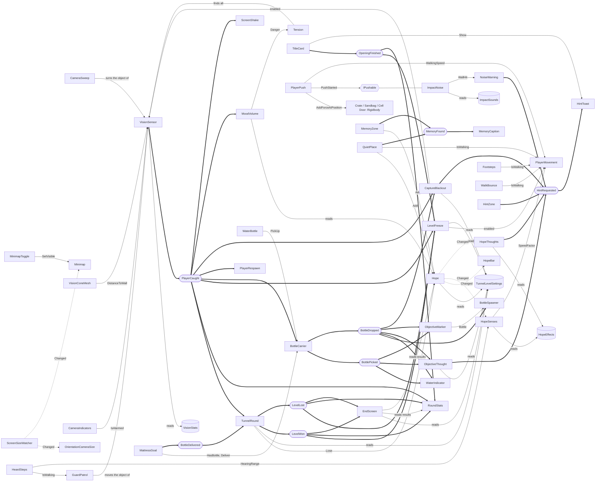

<div dir="rtl" lang="he">

# Light in the Tunnel — מטלה 5 (Dramatic Elements)

מאגר של מטלה 5 בקורס פיתוח משחקי מחשב (5787) באוניברסיטת אריאל. המטלה היא על רכיבים דרמטיים של המשחק "אור במנהרה" (Light in the Tunnel), עם ארבעה סעיפים: אתגר (Challenge), זרימה (Flow), שעשוע (Fun), ורגשות (Emotions).

* התשובות לארבעת סעיפי המטלה: [dramatic-elements.md](dramatic-elements.md)
* המשחק עצמו נמצא כאן, בשורש המאגר: פרויקט Unity של שלב הלימוד ממטלה 4, שהרכיבים הדרמטיים מחוברים אליו ועובדים בו.

השחקן מתעורר בתא במנהרה. הוא צריך לצאת, לעבור את השומר ואת מצלמות האבטחה בלי להיראות, לקחת בקבוק מים מהמחסן ולהחזיר אותו למזרן. הזיכרונות והתפילה נותנים תקווה, והתקווה נותנת לגוף כוח: מהירות, ראייה בחושך ושמיעה.

## איך העבודה נכנסה למאגר

| ענף (Branch) | מה יש בו |
|---|---|
| `design-doc` | הקובץ `dramatic-elements.md`, התשובות לארבעת סעיפי המטלה |
| `section-1-challenge` | מערכת הקושי: פרופילים, מעקב מיומנות, התאמה דינמית |
| `section-2-flow` | מכוון תשומת הלב, גוף התקווה, איסור טקסט שאינו חלק מהעולם |
| `section-3-options` | תוכן אופציונלי, נגישות, עוצמות תוכן, משימות, סיום |
| `master-plan-6-1` | תיקוני תשתית: מנעול תנועה עם סיבות, הרמת אירוע שלא נופלת בגלל מאזין אחד |
| `playable-game` | פרויקט המשחק עצמו, והחיבור של כל הרכיבים האלה לסצנה כך שרואים אותם עובדים |
| `live-ops` | סעיף 10: טעינה דינמית של קונפיגורציה מ-GitHub, ואירוע חי לדוגמה (הפסקת חשמל) |

## הרכיבים הדרמטיים במשחק

### מה רואים כשמשחקים

1. **אזהרת תוכן** (פעם אחת, עד שמאשרים אותה), עם אפשרות לדלג על סצנת הפתיחה.
2. **בחירת קושי**: "Day One" (קל), "The Tunnel" (בינוני), "I Lost the Festival" (קשה).
3. **השלב**: האור החם מסמן את המטרה הנוכחית (הבקבוק, ואחרי שלוקחים אותו המזרן). התקווה יורדת לאט עם הזמן. כשהיא נמוכה שומעים את הנשימה, ובייאוש את הדופק.
4. **רגעים אופציונליים**: ליד קיר הספירה עומדים ומחזיקים E חמש שניות כדי לחרוט קו. עמידה שקטה ליד דלת התא, כשהשומר רחוק, היא רגע של התבוננות בסדק האור. גם התפילה במקום השקט נרשמת.
5. **הסיום**: אחרי שמחזירים את הבקבוק, שורות המספר מופיעות ככתוביות, ואליהן מצטרפות שורות לפי מה שהשחקן עשה (לא נתפס, חרט קו, מצא את כל הזיכרונות).

מקשים: **O** פותח את האפשרויות (נגישות ועוצמת תוכן), **F3** מציג דף שמראה מה המערכות הנסתרות עושות (לצוות ולהצגה, השחקן לא צריך אותו), **E** לפעולה אופציונלית.

### סעיף 1, אתגר: הקושי

| מחלקה | מה היא עושה |
|---|---|
| [Difficulty](Assets/Scripts/Difficulty/Difficulty.cs) | שלוש הרמות: קל, בינוני, קשה |
| [DifficultyProfile](Assets/Scripts/Difficulty/DifficultyProfile.cs), [IDifficultyProfile](Assets/Scripts/Difficulty/IDifficultyProfile.cs) | כל המספרים של רמה אחת, כנכס. כל מערכת שואלת את הממשק ולא מחזיקה מספר משלה |
| [DifficultyProfileFactory](Assets/Scripts/Difficulty/DifficultyProfileFactory.cs) | בונה את שלושת הפרופילים עם המספרים ממסמך העיצוב |
| [DifficultyManager](Assets/Scripts/Difficulty/DifficultyManager.cs) | טוען את הפרופיל שהשחקן בחר (נשמר ב-PlayerPrefs) ומרים את ProfileLoaded |
| [DifficultyApplier](Assets/Scripts/Difficulty/DifficultyApplier.cs) | מכניס את הפרופיל לשלב: תקווה התחלתית, רוחב המבט של המצלמות, קצב השומר. ברמה הבינונית מפעיל את השכבה הדינמית |
| [SkillTracker](Assets/Scripts/Difficulty/SkillTracker.cs) | ציון מיומנות נסתר, מ-10- עד 10, לפי מה שהשחקן עושה |
| [SkillSignals](Assets/Scripts/Difficulty/SkillSignals.cs) | מתרגם את אירועי השלב לאותות של ה-SkillTracker |
| [DifficultyModulator](Assets/Scripts/Difficulty/DifficultyModulator.cs), [ModulationMode](Assets/Scripts/Difficulty/ModulationMode.cs) | כל 30 שניות קורא את הציון ובוחר מצב: Mercy, Ease, Default, Tighten, Challenge. לא משתנה ב-30 השניות הראשונות ולא בזמן ההחשכה שאחרי היתפסות |
| [ModulatedDifficultyProfile](Assets/Scripts/Difficulty/ModulatedDifficultyProfile.cs) | עוטף פרופיל ומכפיל את הערכים שלו לפי המצב הדינמי |
| [CaughtEvent](Assets/Scripts/Difficulty/CaughtEvent.cs), [StageStartedEvent](Assets/Scripts/Difficulty/StageStartedEvent.cs), [StageEndedEvent](Assets/Scripts/Difficulty/StageEndedEvent.cs), [HopeChangedEvent](Assets/Scripts/Difficulty/HopeChangedEvent.cs), [PlayerIdleSignal](Assets/Scripts/Difficulty/PlayerIdleSignal.cs), [QuietPlaceEnteredEvent](Assets/Scripts/Difficulty/QuietPlaceEnteredEvent.cs), [QuietPlaceExitedEvent](Assets/Scripts/Difficulty/QuietPlaceExitedEvent.cs) | האותות של ה-SkillTracker, כל אחד אירוע כנכס מסוג משלו |
| [DigSessionEndedEvent](Assets/Scripts/Difficulty/DigSessionEndedEvent.cs), [ListenActivatedEvent](Assets/Scripts/Difficulty/ListenActivatedEvent.cs) | אותות של חפירה והקשבה. בשלב הלימוד אין חפירה והקשבה, אז הם מוכנים לשלבים הבאים ולא מחוברים כאן |

מה כל רמה משנה בשלב הלימוד: התקווה ההתחלתית (70, 50, 30), מחיר ההיתפסות (5, 10, 20), הדעיכה הטבעית של התקווה (1, 2, 2 לדקה), רוחב המבט של המצלמות (שלושה רבעים, רגיל, פי אחד ורבע), קצב השומר (איטי יותר ברמה הקלה) והתקווה מזיכרון (בקשה שני שלישים). שאר המספרים בפרופיל (חפירה, פנס, יומן, מספר המצלמות, בדיקות התא) שייכים לשלבים שעוד לא נבנו.

### סעיף 2, זרימה: תשומת הלב והגוף

| מחלקה | מה היא עושה |
|---|---|
| [HighlightTarget](Assets/Scripts/Attention/HighlightTarget.cs) | אור על חפץ שאפשר להדליק ולעמעם |
| [AttentionDirector](Assets/Scripts/Attention/AttentionDirector.cs), [AttentionBeat](Assets/Scripts/Attention/AttentionBeat.cs), [AttentionPolicy](Assets/Scripts/Attention/AttentionPolicy.cs) | בכל רגע מטרה אחת מוארת. כל "פעימה" אומרת מה נדלק ומה כבה, והמדיניות מגבילה לארבעה אורות |
| [SceneStateMachine](Assets/Scripts/Attention/SceneStateMachine.cs), [SceneState](Assets/Scripts/Attention/SceneState.cs) | מצבי הסיפור של השלב: מחפשים את המים (BottleDropped), מחזירים אותם (BottlePicked) |
| [ContinuousHope](Assets/Scripts/Player/ContinuousHope.cs) | תקווה עשרונית לצד התקווה השלמה, כדי שדעיכה איטית תצטבר |
| [HopeNaturalDecay](Assets/Scripts/Player/HopeNaturalDecay.cs) | הדעיכה הטבעית, בקצב של הפרופיל. נעצרת כשהשחקן לא יכול לזוז |
| [HopeBody](Assets/Scripts/Player/HopeBody.cs), [HopeTier](Assets/Scripts/Player/HopeTier.cs) | ארבע שכבות התקווה (אמונה, רגוע, חשש, ייאוש) והקולות של הגוף: נשימה ודופק |
| [HudFreeze](Assets/Scripts/UI/HudFreeze.cs) | שומר שלא יופיע על המסך טקסט כמו "GAME OVER" או "SCORE" |

### סעיף 3, שעשוע: אפשרויות, רגעים אופציונליים וסיום

| מחלקה | מה היא עושה |
|---|---|
| [AccessibilitySettings](Assets/Scripts/Accessibility/AccessibilitySettings.cs), [AccessibilityManager](Assets/Scripts/Accessibility/AccessibilityManager.cs) | שמונה הגדרות הנגישות כנכס, והרכיב שטוען ושומר אותן |
| [OptionsMenu](Assets/Scripts/UI/OptionsMenu.cs) | מסך האפשרויות (O). המשחק עומד כשהוא פתוח |
| [SubtitleManager](Assets/Scripts/UI/SubtitleManager.cs), [SubtitleRequest](Assets/Scripts/Accessibility/SubtitleRequest.cs), [SubtitleLanguage](Assets/Scripts/Accessibility/SubtitleLanguage.cs), [SubtitleRequestedEvent](Assets/Scripts/Accessibility/SubtitleRequestedEvent.cs) | כתוביות, עם תור קצר |
| [BodyCaptions](Assets/Scripts/Accessibility/BodyCaptions.cs) | כותב את קולות הגוף ככתובית, למי שלא שומע |
| [VisualCueOverlay](Assets/Scripts/UI/VisualCueOverlay.cs), [VisualCueForSound](Assets/Scripts/Accessibility/VisualCueForSound.cs), [SoundCue](Assets/Scripts/Accessibility/SoundCue.cs), [SoundCueRaisedEvent](Assets/Scripts/Accessibility/SoundCueRaisedEvent.cs) | חץ על המסך לכיוון של צליל. מחובר לצעדי השומר |
| [TypedGameEvent](Assets/Scripts/Accessibility/TypedGameEvent.cs) | בסיס לאירוע כנכס שנושא מידע |
| [HighContrastRenderer](Assets/Scripts/Accessibility/HighContrastRenderer.cs), [BrightnessFloor](Assets/Scripts/Accessibility/BrightnessFloor.cs) | ניגודיות גבוהה, ורצפת בהירות שהתמונה לא יורדת מתחתיה |
| [ColorblindFilter](Assets/Scripts/UI/ColorblindFilter.cs) | צורה (עיגול, ריבוע, משולש) למצב התקווה, כדי שלא יהיה תלוי בצבע |
| [ReducedFlashing](Assets/Scripts/Accessibility/ReducedFlashing.cs), [ScreenShakeGuard](Assets/Scripts/Accessibility/ScreenShakeGuard.cs) | בלי הבהובים פתאומיים, ובלי רעידת מסך. LightFlicker, MoodVolume ו-ScreenShake שואלים אותם |
| [InputMode](Assets/Scripts/Accessibility/InputMode.cs) | הקשות במקום לחיצה ארוכה |
| [ContentIntensity](Assets/Scripts/Intensity/ContentIntensity.cs), [IntensityLevel](Assets/Scripts/Intensity/IntensityLevel.cs), [ContentIntensityManager](Assets/Scripts/Intensity/ContentIntensityManager.cs) | עוצמת התוכן (מרומז או ישיר), ושמירתה |
| [ContentWarningScreen](Assets/Scripts/UI/ContentWarningScreen.cs), [ContentWarningText](Assets/Scripts/Intensity/ContentWarningText.cs), [RightToLeft](Assets/Scripts/UI/RightToLeft.cs) | מסך אזהרת התוכן והטקסט שלו. RightToLeft כותב עברית נכון ברכיב Text הישן |
| [StartMenu](Assets/Scripts/UI/StartMenu.cs), [OpeningGate](Assets/Scripts/UI/OpeningGate.cs), [OpeningSkipRouter](Assets/Scripts/Intensity/OpeningSkipRouter.cs) | המסכים שלפני המשחק, והשער שמחזיק את הפתיחה עד שהם נגמרים או מדלג עליה |
| [IntensityScene](Assets/Scripts/Intensity/IntensityScene.cs), [IntensityVariant](Assets/Scripts/Intensity/IntensityVariant.cs), [IntensityAudio](Assets/Scripts/Intensity/IntensityAudio.cs), [IntensityVisibilityFilter](Assets/Scripts/Intensity/IntensityVisibilityFilter.cs) | גרסה מרומזת או ישירה של סצנה, צליל או חפץ. בשלב הלימוד אין סצנה קשה, אז הם מוכנים לשלבים הבאים |
| [OptionalRegistry](Assets/Scripts/Optional/OptionalRegistry.cs), [OptionalEntry](Assets/Scripts/Optional/OptionalEntry.cs), [OptionalKind](Assets/Scripts/Optional/OptionalKind.cs) | הקטלוג של הרגעים האופציונליים: גילוי, ביטוי, התבוננות |
| [OptionalContent](Assets/Scripts/Optional/OptionalContent.cs), [IOptionalRecorder](Assets/Scripts/Optional/IOptionalRecorder.cs) | זוכר אילו רגעים השחקן רשם בהרצה הזאת |
| [OptionalZone](Assets/Scripts/Optional/OptionalZone.cs), [OptionalAction](Assets/Scripts/Optional/OptionalAction.cs) | אזור שרושם רגע כשעומדים בו, ופעולה בלחיצה ארוכה |
| [SlowMomentsDirector](Assets/Scripts/Optional/SlowMomentsDirector.cs), [CalmSignals](Assets/Scripts/Optional/CalmSignals.cs) | רגע שקט קורה רק כשרגוע: אין שומר קרוב, השחקן לא נתפס עכשיו, והוא עומד. CalmSignals הופך את Tension.Danger לאירועים |
| [OptionalMissions](Assets/Scripts/Missions/OptionalMissions.cs), [OptionalMission](Assets/Scripts/Missions/OptionalMission.cs), [MissionKind](Assets/Scripts/Missions/MissionKind.cs), [OptionalMissionFactory](Assets/Scripts/Missions/OptionalMissionFactory.cs) | שש המשימות השקטות. אין להן רשימה על המסך, הן רק משנות את הסיום |
| [RunState](Assets/Scripts/Missions/RunState.cs), [RunStateTracker](Assets/Scripts/Missions/RunStateTracker.cs) | מה השחקן עשה בהרצה (זיכרונות, היתפסויות), והרכיב שכותב את זה |
| [EndingDirector](Assets/Scripts/Ending/EndingDirector.cs), [EndingSequence](Assets/Scripts/Ending/EndingSequence.cs), [EndingBeat](Assets/Scripts/Ending/EndingBeat.cs), [EndingLanguage](Assets/Scripts/Ending/EndingLanguage.cs), [BonusNarrationLibrary](Assets/Scripts/Ending/BonusNarrationLibrary.cs) | הסיום כרצף של פעימות, ושורות הבונוס לפי המשימות. לשלב הלימוד יש רצף קצר משלו (הנכס TutorialEnding); הסיום המלא של המשחק שייך לשלב האחרון |
| [EndingPresenter](Assets/Scripts/UI/EndingPresenter.cs) | מציג את שורות הסיום ככתוביות, אחת אחרי השנייה |

### תוכנית אב 6.1: תשתית

| מחלקה | מה היא עושה |
|---|---|
| [PlayerMovementLock](Assets/Scripts/Game/PlayerMovementLock.cs) | השחקן זז רק כשאף מערכת לא מחזיקה אותו. כל מערכת נותנת סיבה משלה: LevelFreeze ("opening", "caught", "level ended"), OptionsMenu ("options") |
| [SafeEventRaise](Assets/Scripts/Events/SafeEventRaise.cs) | מרים אירוע כך שמאזין אחד שנכשל לא עוצר את האחרים |
| [DevOverlay](Assets/Scripts/UI/DevOverlay.cs) | דף הבדיקה (F3) |
| [DramaSetup](Assets/Scripts/Editor/DramaSetup.cs) | כלי העורך שמחבר את כל הרכיבים לסצנה: Tools > Tunnel > 4 Setup Dramatic Elements. רץ גם בתוך Tools > Rebuild Scene |

### סעיף 10, ניהול חי (Live Ops)

המשחק מוריד בתחילת כל הרצה את הקובץ [live-ops/live-config.json](live-ops/live-config.json) מהענף `main` ב-GitHub. משנים את הקובץ שם, ובהרצה הבאה המשחק מתנהג אחרת, בלי לבנות גרסה חדשה. בלי רשת המשחק רץ כרגיל. ההסבר על כל שדה ואיך מפעילים את האירוע: [live-ops/README.md](live-ops/README.md).

| מחלקה | מה היא עושה |
|---|---|
| [LiveConfig](Assets/Scripts/LiveOps/LiveConfig.cs) | כל מה שהמשחק קורא מהקובץ. השדות שלה הם המפתחות של ה-JSON |
| [LiveDifficultyNumbers](Assets/Scripts/LiveOps/LiveDifficultyNumbers.cs) | שלושת המספרים של רמת קושי שהקובץ יכול לדרוס. `-1` אומר להשאיר |
| [LivePowerOutage](Assets/Scripts/LiveOps/LivePowerOutage.cs) | ההגדרות של האירוע החי, והשאלה "האם הוא רץ עכשיו" לפי התאריכים |
| [LiveConfigLoader](Assets/Scripts/LiveOps/LiveConfigLoader.cs) | מוריד את הקובץ (עד 5 שניות) ומרים את LiveConfigLoaded, גם אם ההורדה נכשלה |
| [PowerOutage](Assets/Scripts/LiveOps/PowerOutage.cs) | האירוע עצמו, הפסקת חשמל: הנורות כבויות והמצלמות לא רואות, אבל המנהרה חשוכה יותר והשומר ממהר |
| [LiveOpsSetup](Assets/Scripts/Editor/LiveOpsSetup.cs) | כלי העורך שמחבר את שני הרכיבים לסצנה. DramaSetup קורא לו בסוף |

הסדר בזמן ריצה: LiveConfigLoader מוריד את הקובץ ומרים את LiveConfigLoaded. StartMenu מחכה לאירוע הזה לפני שהוא מציע את רמות הקושי, ו-DifficultyManager מעתיק את הפרופיל שנבחר ושם בו את המספרים מהקובץ (`DifficultyProfile.UseLiveNumbers`). PowerOutage מאזין לאותו אירוע, ואם האירוע החי רץ עכשיו הוא מכבה את החשמל: `CameraIndicators.TurnOff`, ‏`HopeSenses.TunnelLightFactor`, ‏`GuardPatrol.AlertFactor`, ואת שורת הפתיחה הוא שולח באירוע OpeningLineChanged (קוד המשחק לא מכיר את הממשק).

### האירועים החדשים

| אירוע | מי מרים | מי מאזין |
|---|---|---|
| WarningAccepted, WarningDeclined | ContentWarningScreen | StartMenu |
| StartChosen | StartMenu | OpeningGate |
| SkipOpening | OpeningSkipRouter | OpeningGate |
| ProfileLoaded | DifficultyManager | DifficultyApplier |
| Caught, StageStarted, StageEnded, HopeChanged, PlayerIdle | SkillSignals | SkillTracker (ו-DifficultyModulator ל-StageStarted) |
| QuietPlaceEntered, QuietPlaceExited | QuietPlace | SkillTracker |
| GuardClose, GuardClear | CalmSignals | SlowMomentsDirector |
| ScriptedBeatStarted, ScriptedBeatEnded | CalmSignals | SlowMomentsDirector, DifficultyModulator |
| SoundCueRaised | VisualCueForSound | VisualCueOverlay |
| SubtitleRequested | BodyCaptions | SubtitleManager |
| LiveConfigLoaded | LiveConfigLoader | StartMenu, PowerOutage |
| OpeningLineChanged (עם טקסט) | PowerOutage | OpeningGate, שמעביר את השורה ל-TitleCard |

שני אירועים נוספים שייכים לנכס שמרים אותם ונמצאים לידו ולא בתיקיית האירועים: `Accessibility/SettingsChanged` (של AccessibilitySettings) ו-`Intensity/ModeChanged` (של ContentIntensity).

### מה שונה מהקוד שנכנס בחמשת הענפים

* OptionalZone עבר מפיסיקה דו-ממדית לתלת-ממדית, כי השחקן זז עם CharacterController.
* ContinuousHope מעביר נקודה לתקווה השלמה רק כשהצטברה נקודה שלמה, ועוקב אחרי שינוי שבא ממקום אחר (זיכרון, היתפסות).
* DifficultyModulator לא משתמש יותר בזמן שלילי כסימן ל"שלב לא התחיל".
* SubtitleManager לא נתקע כשהכתוביות כבויות, ומוצג מעל מסך הסיום.
* HopeBody מקבל עוצמה ומהירות נשימה לכל שכבה, כי יש במשחק הקלטת נשימה אחת.
* HighContrastRenderer פועל ב-LateUpdate, אחרי MoodVolume שכותב את אותו ערך.
* המחלקות שבונות ממשק (SubtitleManager, VisualCueOverlay, ColorblindFilter, ContentWarningScreen) עברו לתיקיית UI, לפי הכלל שקוד המשחק לא מכיר את הממשק.
* כל enum קיבל קובץ משלו, ולכל מספר יש שם.

## קישורים

* המשחק באיץ' (הגרסה של מטלה 4, לפני הרכיבים הדרמטיים; אפשר לשחק בדפדפן): [game-dev-ariel.itch.io/ex4-light-in-the-tunnel](https://game-dev-ariel.itch.io/ex4-light-in-the-tunnel)

## איך מריצים

1. אחרי `git clone` מריצים `git lfs pull`, כי התמונות והצלילים שמורים ב-Git LFS.
2. ב-Unity Hub פותחים את התיקייה של המאגר, בגרסה 6000.3.25f1.
3. פותחים את הסצנה `Assets/Scenes/Tutorial` ולוחצים Play.

הסצנה נבנית מקוד, בכלים שב-`Assets/Scripts/Editor`. אחרי שינוי בכלים מריצים `Tools > Rebuild Scene`. בנייה לדפדפן: `Tools > Build WebGL`. הבנייה יוצאת לתיקייה `../ex4-webgl-builds/ex4-light-in-the-tunnel`, ליד תיקיית הפרויקט ולא בתוכה, כדי שלא תיכנס לגיט.

## איך משחקים

* תנועה: WASD או חצים, אחרי שהעיניים נפתחות בפתיחה. בטלפון יש ג'ויסטיק על המסך. M מציג ומסתיר את המפה.
* דוחפים דלת, ארגז או שק חול כשהולכים לתוכם.
* בפינה המוארת בקיר המסדרון עומדים שלוש שניות בלי לזוז, כדי לומר פסוק.
* **ניצחון**: מביאים את הבקבוק למזרן.
* **הפסד**: כל היתפסות (בפנס של השומר או באור של מצלמה) מורידה 20 תקווה ומחזירה לתא. בלי תקווה היום נגמר.

## פיסיקה

המשחק הזה לבדו משתמש בכל התכונות שנלמדו:

| תכונה | איפה | קובץ |
|---|---|---|
| CharacterController | תנועת השחקן. נעצר בקירות ומחליק לאורכם | [PlayerMovement.cs](Assets/Scripts/Player/PlayerMovement.cs) |
| Rigidbody | ארגזים, שקי חול ודלת התא | [TutorialMapBuilder.cs](Assets/Scripts/Editor/TutorialMapBuilder.cs) (הפונקציה `BuildLooseObjects`) |
| AddForce | השחקן דוחף בכוח שמופעל בנקודת המגע (`AddForceAtPosition`), ולכן ארגז גם מסתובב. בכל פריים הדחיפה היא מתקף של כוח כפול זמן הפריים, כך שהיא זהה בכל קצב פריימים | [PlayerPush.cs](Assets/Scripts/Player/PlayerPush.cs) |
| Raycast | המצלמות והשומר: קרניים שנעצרות בקיר קובעות גם מה הם רואים וגם איך נראה קונוס האור. ארגז שנדחף עוצר אותן, אז אפשר להסתתר מאחוריו | [VisionSensor.cs](Assets/Scripts/Security/VisionSensor.cs) |
| Collision | ארגז או שק חול שנדחף בודק במה פגע ובאיזו מהירות. מכה בקיר עושה רעש, וככל שהיא מהירה יותר הרעש חזק יותר. לכל סוג יש צלילים משלו, בנכס [ImpactSounds](Assets/Scripts/Level/ImpactSounds.cs) | [ImpactNoise.cs](Assets/Scripts/Level/ImpactNoise.cs) |
| מחבר (רשות) | דלת התא תלויה על HingeJoint ונפתחת כשנשענים עליה | [TutorialMapBuilder.cs](Assets/Scripts/Editor/TutorialMapBuilder.cs) (הפונקציה `CreateHingedDoor`) |

המנהרה מצוירת בדו-ממד, אבל הפיסיקה תלת-ממדית: לכל קיר שנוגע ברצפה יש BoxCollider, והכול זז על מישור X-Y. ההסבר בהחלטה 2 למטה.

## מבנה התיקיות

<div dir="ltr">

```
Assets/
├── Scripts/        LightInTheTunnel.asmdef (the game code)
│   ├── Player/     PlayerMovement, PlayerPush, PlayerRespawn, Hope, HopeSenses, HopeThoughts, HopeEffects, BottleCarrier
│   │               assignment 5: ContinuousHope, HopeNaturalDecay, HopeBody, HopeTier
│   ├── Security/   VisionSensor, VisionStats, VisionConeMesh, CameraSweep, CameraIndicators, GuardPatrol, HeardSteps
│   ├── Items/      WaterBottle, BottleSpawner, MattressGoal
│   ├── Level/      HintZone, MemoryZone, QuietPlace, ImpactNoise, ImpactSounds, NoiseWarning, IPushable
│   ├── Game/       TunnelRound, RoundStats, LevelFreeze, TunnelLevelSettings, PlayerMovementLock
│   ├── Events/     GameEvent, TextEvent   (ScriptableObject), SafeEventRaise
│   ├── Difficulty/ Attention/ Accessibility/ Intensity/ Optional/ Missions/ Ending/ LiveOps/
│   │               the dramatic elements of assignment 5 (see the tables above)
│   ├── UI/         HUD: ScreenVignette, HopeBar, WaterIndicator, ObjectiveThought, CaptureBlackout
│   │               HintToast, MemoryCaption, TitleCard, EndScreen, ObjectiveMarker, Minimap, MinimapToggle,
│   │               MobileJoystick, ButtonFeel, ScreenFader, UiFactory, UiAnim, UiTheme
│   │               assignment 5: StartMenu, OpeningGate, OptionsMenu, DevOverlay, ContentWarningScreen, SubtitleManager,
│   │               VisualCueOverlay, ColorblindFilter, EndingPresenter, HudFreeze, RightToLeft
│   ├── Effects/    MoodVolume, Tension, ScreenShake, LightFlicker, DustMotes, WalkBounce, Bob
│   ├── Audio/      Footsteps, MusicPlayer, Sfx
│   ├── Camera/     CameraFollow, OrientationCameraSize, ScreenSizeWatcher
│   └── Editor/     the tools that build the scene (LightInTheTunnel.Editor.asmdef):
│                   ProjectBuilder (Rebuild Scene, Build WebGL), TunnelAssets, SetupTools, SceneParts, PlaceholderSprites,
│                   1 map:  TutorialMapBuilder, TutorialLayout, WallColliderBuilder, LooseObjectBuilder, WatcherBuilder
│                   2 game: TunnelLevelSetup
│                   3 feel: GameFeelSetup, LightSetup, MoodSetup, SoundSetup, TeachingSetup, HudSetup
│                   4 drama: DramaSetup
├── Data/           Events/ (PlayerCaught, BottlePicked, BottleDropped, BottleDelivered, OpeningFinished,
│                   LevelWon, LevelLost, HintRequested, MemoryFound),
│                   TutorialLevelSettings, HopeEffects, SecurityCameraVision, RoomCameraVision, GuardVision,
│                   CrateSounds, SandbagSounds,
│                   assignment 5: the new events (see the table above), Difficulty/ (Easy, Medium, Hard),
│                   Accessibility/, Intensity/, Optional/ (OptionalRegistry), Ending/ (TutorialEnding, BonusNarration)
├── Tests/
│   ├── Common/     TestUtils, TestData, EventSpy   (LightInTheTunnel.Tests.Common.asmdef)
│   ├── EditMode/   Events, Player, Game, Level, Security, UI, Data, Scene, Architecture, EditorTools,
│   │               Difficulty, Attention, Accessibility, Intensity, Optional, Missions, Ending
│   │               (LightInTheTunnel.Tests.EditMode.asmdef)
│   └── PlayMode/   Scene, Player, Game, Items, Level, Security, UI, Effects, Audio, Camera, Helpers
│                   (LightInTheTunnel.Tests.PlayMode.asmdef)
├── Prefabs/  Scenes/  Sprites/  Tiles/  Resources/  Settings/
```

</div>

`Game` מחזיקה את החוקים (מתי מנצחים ומפסידים, מתי השחקן יכול לזוז), ו-`UI` מציגה. קוד המשחק לא מכיר את קוד הממשק: הממשק מאזין לאירועים של המשחק, ולא להפך. הממשק גם לא משנה את המשחק: הוא לא מכבה את השחקן ולא עוצר את השלב, את זה עושה LevelFreeze.

## יחסי המחלקות

יש שני סוגי אירועים:

* **אירוע כנכס** ([GameEvent](Assets/Scripts/Events/GameEvent.cs), [TextEvent](Assets/Scripts/Events/TextEvent.cs)): ScriptableObject שרכיב אחד מרים ואחרים מאזינים לו. השולח והמאזינים מחזיקים רק את הנכס ולא מכירים זה את זה.
* **אירוע רגיל של C#** (`event Action`): כשהמאזין ממילא מחזיק הפניה לשולח, כמו HopeBar שמציג את התקווה, או Minimap שמאזין ל-ScreenSizeWatcher.

כל הרשמה נעשית ב-`OnEnable` ומבוטלת ב-`OnDisable`.

בתרשים: מלבן הוא מחלקה, צורה מעוגלת היא אירוע כנכס (חץ עבה), גליל הוא נכס נתונים ב-`Assets/Data`, חץ מקווקו הוא אירוע רגיל של C#, וחץ רגיל הוא קריאה ישירה.

<div dir="ltr">



</div>

| אירוע | מי שולח | מי מקבל |
|---|---|---|
| PlayerCaught | VisionSensor (של כל מצלמה ושל השומר) | TunnelRound (מוריד תקווה), RoundStats (סופר), LevelFreeze (מקפיא את השחקן לרגע), BottleCarrier (מפיל את הבקבוק), PlayerRespawn (מחזיר לתא), CaptureBlackout (מסך שחור), MoodVolume, ScreenShake |
| OpeningFinished | TitleCard | LevelFreeze (השחקן יכול לזוז), RoundStats (השעון מתחיל) |
| BottlePicked | BottleCarrier | WaterIndicator, ObjectiveThought, ObjectiveMarker |
| BottleDropped | BottleCarrier (רק כשנתפסים עם הבקבוק) | BottleSpawner (בקבוק חדש), WaterIndicator, ObjectiveThought, ObjectiveMarker, CaptureBlackout |
| BottleDelivered | MattressGoal | TunnelRound |
| LevelWon, LevelLost | TunnelRound | LevelFreeze (עוצר את השחקן ואת הצופים מיד, ואת השלב אחרי ההחשכה), RoundStats (השעון נעצר), EndScreen |
| HintRequested | HintZone, NoiseWarning, HopeThoughts, ObjectiveThought, CaptureBlackout | HintToast |
| MemoryFound | MemoryZone, QuietPlace | MemoryCaption |
| Hope.Changed (C#) | Hope | HopeBar, HopeSenses, HopeThoughts |
| ScreenSizeWatcher.Changed (C#) | ScreenSizeWatcher | OrientationCameraSize, Minimap |

המצלמה בנויה מרכיבים קטנים על אותו אובייקט: CameraSweep מסובב, VisionSensor רואה, VisionConeMesh מצייר את מה שהחיישן רואה, ו-CameraIndicators מוסיף נורה וזמזום. השומר בנוי מאותם VisionSensor ו-VisionConeMesh, ורק מה שמזיז אותו שונה: GuardPatrol במקום CameraSweep.

התקווה משנה את הגוף דרך [HopeSenses](Assets/Scripts/Player/HopeSenses.cs): ככל שיש יותר תקווה הגיבור הולך מהר יותר, רואה רחוק יותר בחושך (רדיוס האור סביבו והבהירות של כל המנהרה) ושומע את צעדי השומר ממרחק גדול יותר, גם מאחורי קיר. [HopeThoughts](Assets/Scripts/Player/HopeThoughts.cs) כותב מחשבה כשהתקווה עוברת רמה, כדי שהשחקן ישים לב לשינוי. המספרים בנכס [HopeEffects](Assets/Data/HopeEffects.asset).

ה-HUD בנוי מחלקים קטנים על אובייקט אחד, וכל אחד מציג דבר אחד: ScreenVignette (שוליים כהים), HopeBar (להבה, פס ו-"+N hope"), WaterIndicator (טיפת המים), ObjectiveThought (המטרה, מתחת לפס) ו-CaptureBlackout (המסך השחור אחרי היתפסות). המילים והזמנים שלהם הם שדות ב-Inspector.

## החלטות ארכיטקטורה

**1. אירועים כנכסים במקום GameManager.** במטלה 3 היה `GameManager` שהיה סינגלטון: המצלמה קראה ל-`GameManager.Instance.RegisterCapture()`, וה-HUD קרא ממנו את החיים בכל פריים. הוא החזיק את החיים, את הבקבוק, את מספר ההיתפסויות ואת מעבר הסצנות, וכל שינוי במשחק נגע בו. עכשיו המצלמה רק מרימה את `PlayerCaught`, וכל מי שצריך מגיב בעצמו. את GameManager פירקנו ל-Hope, BottleCarrier, PlayerRespawn ו-TunnelRound. החלופה הייתה להשאיר את הסינגלטון ולהוסיף לו אירועים, אבל אז עדיין כולם היו תלויים במחלקה אחת.

**2. CharacterController בלי לבנות את המנהרה מחדש בתלת-ממד.** המנהרה מצוירת בדו-ממד (Tilemap ותאורה דו-ממדית), ו-CharacterController הוא רכיב תלת-ממדי. החלופה הייתה לבנות את המנהרה מחדש מקוביות, אבל אז היינו מאבדים את התאורה והאווירה ממטלה 3. במקום זה השארנו את הציור כמו שהוא והחלפנו רק את הפיסיקה: לכל קיר שנוגע ברצפה יש BoxCollider תלת-ממדי, השחקן הוא CharacterController שהגובה שלו שווה לפעמיים הרדיוס (כלומר כדור) והוא זז על מישור X-Y, והמצלמות משתמשות ב-`Physics.Raycast`. השחקן נמצא בשכבה Ignore Raycast, כדי שהקרניים ייעצרו רק בקירות ובארגזים. על הקירות נשאר גם קוליידר דו-ממדי, רק כי הצללים של התאורה לוקחים ממנו את הצורה.

**3. מסך הסיום באותה סצנה.** במטלה 3 מסך הסיום היה סצנה נפרדת, ולכן ה-GameManager היה צריך לשרוד את המעבר (DontDestroyOnLoad) כדי להעביר את התוצאות. עכשיו EndScreen יושב בסצנת השלב, מאזין ל-`LevelWon` ו-`LevelLost` ומכסה את המסך. אין מידע שעובר בין סצנות, ולכן לא צריך אובייקט ששורד. "Play again" פשוט טוען את הסצנה מחדש.

**4. ההקפאה של השחקן בקוד המשחק ולא בממשק.** קודם ה-HUD כיבה את PlayerMovement בזמן המסך השחור שאחרי היתפסות, ומסך הסיום כיבה את השחקן, הצופים והצלילים. זה אומר שהממשק שינה את המשחק, ושבזמן שמסך הסיום החשיך השחקן עוד היה יכול להיתפס. עכשיו [LevelFreeze](Assets/Scripts/Game/LevelFreeze.cs) מחליט מתי משחקים: לא בזמן הפתיחה (עד ש-TitleCard מרים `OpeningFinished`), לא לרגע אחרי היתפסות, ובסוף השלב הוא עוצר מיד את השחקן ואת ה-VisionSensor-ים, ואחרי ההחשכה מכבה את השחקן, הצופים והצלילים. הזמנים נמצאים ב-[TunnelLevelSettings](Assets/Data/TutorialLevelSettings.asset) (`caughtFreezeSeconds`, `endFadeSeconds`), ו-CaptureBlackout ו-EndScreen קוראים את אותם מספרים, כך שהמסך שחור בדיוק כל עוד השחקן מוקפא ואין שני טיימרים לסנכרן. החלופה הייתה להשאיר את ההקפאה בממשק, כי משך הקיפאון הוא משך האנימציה. ויתרנו עליה כי אז מי שמחליף את הממשק (למשל במשחק התלת-ממדי) שובר את המשחק.

כל המספרים לכוונון נמצאים בנכסים ב-`Assets/Data` (הגדרות השלב, השפעת התקווה, הראייה של כל סוג צופה) או בשדות Inspector.

## איך מוסיפים סוג אויב חדש

כך הוספנו את השומר, אחרי שהמצלמה כבר עבדה. אלה הקבצים שבאמת השתנו:

1. [GuardPatrol.cs](Assets/Scripts/Security/GuardPatrol.cs): סקריפט חדש שמוליך אותו בין נקודות ומסובב את האובייקט, כך שה-VisionSensor שעליו מסתכל לאן שהשומר מסתכל.
2. [HeardSteps.cs](Assets/Scripts/Security/HeardSteps.cs): סקריפט חדש שמציג את הצעדים שלו כטבעת, רק כשהגיבור קרוב מספיק לשמוע. זה מיוחד לשומר, אויב אחר לא חייב אותו.
3. נכס VisionStats חדש, [GuardVision](Assets/Data/GuardVision.asset) (ראייה רחבה וקצרה יותר), ותכונה בשבילו ב-[TunnelAssets.cs](Assets/Scripts/Editor/TunnelAssets.cs).
4. המיקום שלו במפה: `PlaceGuard` ב-[WatcherBuilder.cs](Assets/Scripts/Editor/WatcherBuilder.cs). הוא שם אותו תחת `Watchers`, עם VisionSensor ו-VisionConeMesh הקיימים.

שום קובץ אחר לא השתנה, כי השומר מרים את אותו `PlayerCaught`, וכל מה שקורה כשנתפסים (תקווה, חזרה לתא, בקבוק, מסך, צליל) כבר מאזין לו. גם Tension, שמגביר את הדופק ליד סכנה, מחפש כל VisionSensor ולא "מצלמה", ו-LevelFreeze עוצר כל VisionSensor שתחת `Watchers` בסוף השלב. המצלמה השנייה במחסן היא אפילו פחות מזה: רק נכס VisionStats נוסף ותו `v` במפה. אויב מסוג אחר לגמרי, למשל כלב ששומע במקום לראות, יצטרך סקריפט חיישן משלו שמרים את אותו אירוע.

**חפץ חדש שאפשר לדחוף**, למשל חבית:

1. נכס [ImpactSounds](Assets/Scripts/Level/ImpactSounds.cs) חדש עם הצלילים שלה (כמו [CrateSounds](Assets/Data/CrateSounds.asset) ו-[SandbagSounds](Assets/Data/SandbagSounds.asset)), ותכונה בשבילו ב-[TunnelAssets.cs](Assets/Scripts/Editor/TunnelAssets.cs).
2. קובצי הצליל ב-`Assets/Resources/Audio`.
3. תו חדש במפה ב-[TutorialLayout.cs](Assets/Scripts/Editor/TutorialLayout.cs), ו-`case` שלו ב-`Build` של [LooseObjectBuilder.cs](Assets/Scripts/Editor/LooseObjectBuilder.cs) (גודל, משקל וצלילים).

PlayerPush, ImpactNoise ו-NoiseWarning לא משתנים. PlayerPush מכיר רק את הממשק [IPushable](Assets/Scripts/Level/IPushable.cs) ולא יודע אם זה ארגז או חבית, ו-NoiseWarning שומע את כל החפצים ומזהיר פעם אחת בשלב.

**חפץ חדש**, למשל זיכרון נוסף: עוד שורה ב-[TeachingSetup.cs](Assets/Scripts/Editor/TeachingSetup.cs) שמוסיפה MemoryZone עם טקסט וכמות תקווה. בלי קוד חדש.

## סינגלטון ומשתנים סטטיים

בקוד של מטלה 4 אין סינגלטון. במטלה 5 נוספו כמה נקודות גישה סטטיות, כולן ברשימה למטה, והבדיקה NoSingletons לא מרשה להוסיף אחרות. ה-GameManager ממטלה 3 נמחק, וגם `Tension.Danger` ו-`ScreenShake.Shake` שהיו סטטיים הפכו לרכיבים רגילים. גם האזהרה על רעש (פעם אחת בשלב) היא רכיב בסצנה, NoiseWarning, ולא משתנה סטטי, כדי שתתאפס כשהשלב נטען מחדש.

| איפה | מה | למה |
|---|---|---|
| [Sfx](Assets/Scripts/Audio/Sfx.cs) | מחלקה סטטית עם AudioSource אחד | צליל קצר צריך להמשיך גם כשהסצנה נטענת מחדש (הקליק של Play again), אז המקור שלו לא יכול להיות שייך לסצנה. אין בו מצב של המשחק |
| [ScreenFader](Assets/Scripts/UI/ScreenFader.cs) | `FadeAndLoad` סטטית ודגל `isFading` | המסך השחור חייב לשרוד את טעינת הסצנה כדי להתבהר אחריה. הדגל מונע טעינה כפולה. בפרויקט Play מתחיל בלי לטעון את הקוד מחדש (Enter Play Mode Options), אז `ResetStatics` עם `[RuntimeInitializeOnLoadMethod]` מאפס את הדגל בתחילת כל הרצה |
| UiFactory, UiAnim, UiTheme | מחלקות סטטיות של פונקציות עזר וקבועים | אין בהן מצב, רק פונקציות שמקבלות קלט ומחזירות פלט |
| `MobileJoystick.UsesTouch` | תכונה סטטית | שאלה על המכשיר ולא על אובייקט מסוים |
| [DifficultyManager](Assets/Scripts/Difficulty/DifficultyManager.cs) | `Current` ו-`CurrentAsset` סטטיים | הפרופיל הוא בחירה אחת שכל מערכת קוראת (TunnelRound, MemoryZone, HopeNaturalDecay), ומערכת שנוצרת בזמן המשחק לא יכולה לקבל הפניה ב-Inspector. הרכיב עצמו נמצא בסצנה, ו-`ResetStatics` מאפס את הערכים בתחילת כל הרצה |
| [ContentIntensityManager](Assets/Scripts/Intensity/ContentIntensityManager.cs) | `Current` סטטי | עוצמת התוכן היא בחירה אחת של השחקן, וכל סצנה, צליל או חפץ עם שתי גרסאות קורא אותה |
| [AccessibilityManager](Assets/Scripts/Accessibility/AccessibilityManager.cs), [AccessibilitySettings](Assets/Scripts/Accessibility/AccessibilitySettings.cs) | `Instance`, ו-`AccessibilitySettings.Current` | ההגדרות של השחקן נקראות מכל מקום, גם ממחלקות סטטיות בלי אובייקט (ReducedFlashing, ScreenShakeGuard, InputMode). הן נשמרות ב-PlayerPrefs ואינן מצב של המשחק |
| `ReducedFlashing.ShouldFlash` | תכונה סטטית | שאלה על ההגדרה, בלי מצב משלה |
| [OptionalContent](Assets/Scripts/Optional/OptionalContent.cs), [OptionalMissions](Assets/Scripts/Missions/OptionalMissions.cs) | `Instance` לרכיב שבסצנה | אזורים ופעולות שמפוזרים בשלב רושמים רגע בלי שכל אחד יחובר ביד. הרכיב שייך לסצנה, ה-`Instance` מתנקה כשהיא נסגרת, ו-`ResetStatics` מאפס אותו בתחילת כל הרצה |

## בדיקות

**מריצים את כל הבדיקות לפני כל מיזוג (merge), וממזגים רק כשהכול ירוק.** כך שינוי לא שובר משהו בשקט.

יש שני סוגים של בדיקות:

* **EditMode** (בלי להפעיל את המשחק, כמה שניות): הלוגיקה עצמה (אירועים, תקווה, חוקי השלב, הבקבוק, עוצמת הצלילים, המחשבות על התקווה), נכסי הנתונים ב-`Assets/Data` (נטענים ומספרים הגיוניים), החיווט של הסצנה (אין סקריפט חסר ואין שדה הפניה ריק), וכלי העורך: `Rebuild Scene` רץ פעמיים, ובודקים שהסצנה שנבנתה תקינה, שבנייה שנייה לא מוסיפה אובייקטים, ושהיא זהה לסצנה שבמאגר. הקבצים שהכלים שומרים מוחזרים בסוף הבדיקה למצבם.
* **PlayMode** (המשחק רץ, כחצי דקה): הסצנה האמיתית (נטענת ורצה בלי שגיאות, היתפסות, ניצחון, הפסד, Play again), וכל סקריפט בנפרד באובייקטים שנבנים בקוד: תנועה וקירות, הדחיפה (זהה ב-30 וב-120 פריימים בשנייה), ראייה דרך קיר, השומר, חלקי ה-HUD, מסך הסיום, האפקטים, הצלילים והמצלמה. כל פריים הוא 1/60 שנייה של זמן משחק (`Time.captureFramerate`), כך שהתוצאות זהות בכל הרצה. בזמן בדיקות PlayMode הקול מושתק (`AudioListener.volume = 0`), והבדיקות של הצלילים בודקות מה הופעל ולא מה נשמע.

לכל תקלה שתוקנה בענף `cleanup` יש בדיקה עם שם התקלה, למשל `Push_IsTheSame_At30And120FramesPerSecond`, `CaughtAfterWin_ChangesNothing`, `IsWalking_IsFalse_WhenWalkingIntoAWall` ו-`MemoryCaption_TurnedOffAndOnAgain_StillShowsMemories`.

**בדיקות ארכיטקטורה** (EditMode, בקובץ [ArchitectureTests.cs](Assets/Tests/EditMode/Architecture/ArchitectureTests.cs)) קוראות את הקוד ובודקות את הכללים של הקורס ושל ה-README:

* קוד המשחק לא משתמש במחלקות של `UI`.
* כל הרשמה לאירוע נעשית ב-`OnEnable` ומבוטלת ב-`OnDisable`.
* אין סינגלטון, וכל משתנה סטטי שמחזיק מצב מופיע בטבלה של המשתנים הסטטיים למעלה ומתאפס בתחילת כל הרצה.
* בכל קובץ טיפוס אחד, בשם הקובץ.
* לכל מספר כוונון בקוד המשחק יש `[Tooltip]`, `[Range]` או `[Min]`, בלי חריגים.
* **אין מספרי קסם** ([NoMagicNumbersTests.cs](Assets/Tests/EditMode/Architecture/NoMagicNumbersTests.cs)): כל מספר ב-`Assets/Scripts`, גם בכלי העורך, מגיע משם. מותר לכתוב מספר רק במקום שבו הוא מקבל שם או הסבר: קבוע (`const` או `static readonly`) עם הערה, ערך ההתחלה של שדה ב-Inspector (עם `[Tooltip]`), או בתוך תכונה כמו `[Range]`. בכל מקום אחר מותרים רק 0, 1, 2 ו-0.5 (כלום, אחד, כפול, חצי). הבדיקה מוחקת קודם הערות וטקסטים, אז "Day 1" בתוך מחרוזת לא נחשב.
* ה-README מזכיר כל מחלקה וכל אירוע, ולכן תיעוד שלא עודכן נכשל.
* הרווחים לפי `.editorconfig` (מה שבודק הקוד של הקורס דורש).

**איך מריצים ב-Unity:** `Window > General > Test Runner`, בלשונית `EditMode` לוחצים `Run All`, ואחר כך באותו אופן בלשונית `PlayMode`.

**איך מריצים משורת הפקודה** (Unity סגור), פעם עם `EditMode` ופעם עם `PlayMode`:

<div dir="ltr">

```
/Applications/Unity/Hub/Editor/6000.3.25f1/Unity.app/Contents/MacOS/Unity -batchmode -projectPath . \
  -runTests -testPlatform EditMode -testResults ../test-results/editmode.xml -logFile ../test-results/editmode.log
```

</div>

לא מוסיפים `-quit`, יוניטי נסגר לבד בסוף. קוד היציאה 0 אומר שהכול עבר, ו-2 אומר שיש בדיקה שנכשלה. הפירוט בקובץ ה-XML.

**כיסוי קוד:** החבילה Code Coverage מודדת כמה מקוד המשחק הבדיקות מריצות (היום כ-90% מהשורות). ב-Unity: `Window > Analysis > Code Coverage`, מסמנים `Enable Code Coverage`, מריצים את הבדיקות ולוחצים `Generate Report`. משורת הפקודה מוסיפים לשתי ההרצות:

<div dir="ltr">

```
-enableCodeCoverage -coverageResultsPath ../coverage-tunnel
-coverageOptions "generateHtmlReport;generateAdditionalMetrics;assemblyFilters:+LightInTheTunnel"
```

</div>

הדוח נפתח מ-`../coverage-tunnel/Report/index.html`. התוצאות נשמרות מחוץ לפרויקט, כדי שלא ייכנסו לגיט.

## הצוות

* דוד בלוך ([davidbloch18](https://github.com/davidbloch18))
* עומרי סבג ([omrisabag2001](https://github.com/omrisabag2001))

**מסמכי העיצוב** ([Light-in-the-Tunnel](https://github.com/Game-development-Ariel/Light-in-the-Tunnel)):.

</div>
