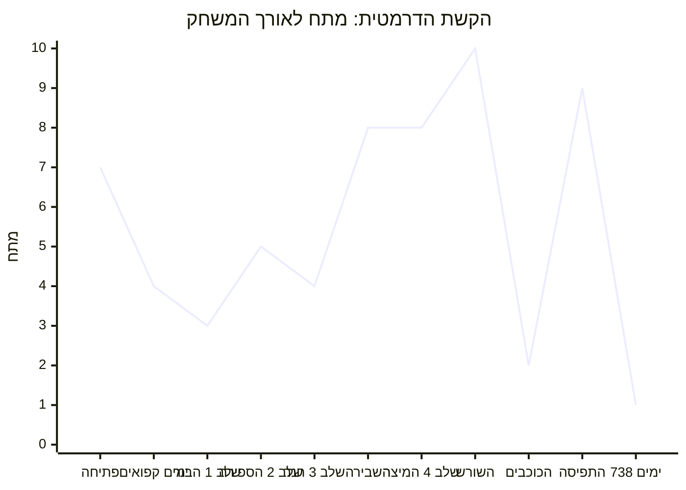

# אור במנהרה: רכיבים דרמטיים

המסמך עונה על עשרת הנושאים של מטלה 5. כל תשובה כתובה כהנחיה לתכנות: מה קורה במשחק, באיזה רכיב, ועם אילו מספרים.

**איך לקרוא:**
* **קיים** מציין רכיב שכבר נמצא בקוד של שלב הלימוד.
* **חדש** מציין רכיב שעוד צריך לבנות.
* **השמות בקוד:** בטקסט כל רכיב מופיע בשם עברי. השם שלו בקוד מופיע בנספח בסוף המסמך, וגם קודי הצבעים.
* **ליבה ומודולים:** המסמך מתאר את הליבה, כלומר מה שחייב להיות כדי שיהיה משחק. תוספות שאפשר להדליק או לכבות מרוכזות בפרק "מודולים להרחבה", אחרי נושא 8.
* כל המספרים הם ערכים התחלתיים. הם נשמרים בנכסי נתונים ולא בקוד, ומכווננים אחרי בדיקות עם שחקנים.

**על הסיפור:** המשחק בדיוני, בהשראת עדויות של חטופים מ-7 באוקטובר. לגיבור אין שם. ביומן הוא "אני".

---

## מפת המשחק

כל המשחק לפי הסדר. כל פרק במסמך משתמש באותם שמות של חלקים.

| # | חלק | יום | איפה | מה עושים | רגש מרכזי |
|---|---|---|---|---|---|
| 0 | **הפתיחה** | 7 באוקטובר | מסיבה בזריחה | רוקדים, ואז נחטפים. בסוף אין שליטה | שמחה, ואז אימה |
| 1א | **הימים הקפואים** | ימים 1 עד 5 | התא | הגיבור לא זז. בכל יום הוא אוכל מהמגש, ויש לו פעולה אחת. התקווה עולה מ-15 ל-30 | פחד שמשתק |
| 1ב | **שלב 1, הבור** | יום 5 | התא והמסדרון | להשתחרר מהחבל, למצוא את היומן, להביא את הבקבוק מהמסדרון. שומר רק עובר ליד הדלת | ניצוץ ראשון של תקווה |
| 2 | **שלב 2, הספירה** | יום 23 | המסדרונות | ללמוד את השומר המסייר. שתי משימות: החריטות והשקים, ואוכל מהמחסן. כאן נתפסים בפעם הראשונה | מתח וסבלנות |
| 3 | **שלב 3, הנר** | יום 140 | חדר החשמל, המסדרון שקרס | לאסוף חלקים, לבנות אור, לחפור 3 מטרים. **באמצע השלב: נקודת השבירה** | נחישות, ובאמצע ייאוש |
| 4 | **שלב 4, המיצר** | "הלילה" | המנהרה שהוא חופר | לחפור עוד 7 מטרים. סוללה של 95 שניות, ובדיקה של התא בערך כל דקה | הכול או כלום |
| 5 | **הסוף** | עד יום 738 | בחוץ | הכוכבים, התפיסה, הספירה עד 738, הזריחה וההודעה על השחרור. אין שליטה | שקט, אובדן, ואז כבוד |

---

## 1. אתגר

### 1.1 אילו כישורים יידרשו כדי לשחק במשחק?

המשחק דורש **שילוב הדוק של שלושה כישורים**. אף אחד מהם לבדו לא מספיק, וההישרדות תלויה בכך שהשחקן ישתמש בשלושתם יחד בכל יציאה מהתא.

**1. תזמון והאזנה (סבלנות).** השחקן חייב להמתין לרגעים הנכונים: השומר עובר במסדרון כל עשרים שניות בשלב 1, וכל חצי דקה בשלב 2, וגם בודק את התא באקראי כל 45 עד 60 שניות. רק מקש ההאזנה (מחזיקים F, הגיבור לא זז) חושף טבעות צעדים דרך הקירות. מי שרץ בלי להאזין – נתפס.

**2. ניהול סיכון בחפירה (שיפוט).** הלב של המשחק: השחקן מחזיק את מקש הפעולה ליד השקים, וההתקדמות נשמרת. כל שנייה מוסיפה 0.15 מטר בחפירה. בכל יציאה צריך להחזיר את השק למקומו (כשתי שניות) לפני שהשומר בודק. השאלה החוזרת של השחקן: "עוד מטר אחד, או חוזרים?" שחקן חמדן יוכל לחפור ארבעה מטרים ביציאה אחת – אבל יש סיכוי של בערך 30% שהשומר יבדוק באמצע. שחקן זהיר יחפור מטר בלבד ליציאה, עם סיכוי היתפסות של כ-5%.

**3. ניהול תקווה ומשאבים (זיכרון).** השחקן צריך לזכור איפה דפי הקודמים (5 תקווה לכל דף), מתי להשתמש בתפילה (כמה שניות במקום שקט, 20 תקווה, פעם בשלב), ומתי להדליק את האור שבנה (סוללה של 95 שניות לכל שלב 4). שחקן שמדליק את האור בכל יציאה יחפור את המטרים האחרונים בחושך.

**איך השלושה משתלבים.** החפירה עצמה דורשת את כל השלושה: סבלנות (לחכות לחלון של 45 שניות בין בדיקות השומר), ניהול סיכון (כמה מטרים להעז הפעם), וניהול משאבים (האם להדליק את האור, או לחפור בחושך, לאט פי שניים).

**דוגמה קונקרטית משלב 2 (הספירה).** השחקן נמצא בצומת שהשומר עובר כל חצי דקה. במרחק 3 משבצות מהצומת יש את השקים. במרחק 7 משבצות יש פינה שקטה לתפילה. במרחק 12 משבצות יש דף של הקודמים. המסלולים חותכים זה את זה. ההחלטה שבפניו: ללכת קודם לתפילה (20 תקווה, פעם בשלב) ואחר כך לשקים; או ללכת לדף הרחוק (5 תקווה) אבל המסלול עובר פעמיים מתחת לאור של מצלמה; או לוותר הפעם ולגשת מיד לשקים, וזה חוסך זמן אבל משאיר אותו עם תקווה נמוכה, קרוב לסף של מצב ייאוש.

בחירה שגויה אינה "הפסד": היא היתפסות, שמורידה 10 תקווה ומחזירה לתא. השחקן חוזר – עם פחות משאבים, ועם ידע נוסף על הצומת.

### 1.2 מה ישתנה בין שלוש רמות הקושי?

שלוש רמות, וכל רמה משנה משתנים משלושת צירי הכישור במקביל (שומרים, משאבים, חפירה). כך לא נוצרת "רמה שהיא קלה בציר אחד ובלתי אפשרית באחר", והטעם הדרמטי של כל רמה שונה.

**רמה קלה – "יום ראשון".** ברמה זו המשחק פותח יותר חלונות הזדמנות בכל אחד מצירי הכישור, כך שהשחקן שעדיין לומד את החוקים לא ייתפס שוב ושוב ולא יאבד את החוט.

בציר השומרים, הזמן בין בדיקות התא עולה מ-45 עד 60 שניות לטווח של 70 עד 90 שניות - כפול כמעט מברירת המחדל, כך שחפירה נינוחה אפשרית. מחזור הסיור של השומר ארוך יותר, 40 שניות במקום חצי דקה בשלב 2, מה שנותן לשחקן זמן רב יותר בכל פינה בין חלוף אחד לבא.

בציר המצלמות, קוני הראייה צרים יותר - 45 מעלות במקום 60, כך שאזורי מחבוא רבים יותר נשארים מחוץ לשדה. מספר המצלמות בשלב יורד מחמש לשלוש, כך שהתמרון ביניהן פשוט יותר.

בציר המשאבים, כל שלב מתחיל לפחות מ-40 תקווה במקום 30, יש לו מרחב נשימה רגשי מההתחלה. היתפסות מורידה 5 תקווה במקום 10, כך שטעות אחת לא גוזרת את השלב. הסוללה של האור מחזיקה 120 שניות במקום 95.

בציר החפירה, המהירות עולה מ-0.15 מטר לשנייה ל-0.20, כך שחור של שישה מטרים נחפר בשלושים שניות פחות. הרעש של החפירה נשמע רק במסדרון הצמוד, במקום בשני מסדרונות, כך שהסיכוי שהשומר ייגרר לכיוון החפירה קטן יותר.

לבסוף, היומן מציג רמז קונקרטי אחרי שתי היתפסויות - למשל "השומר בודק את התא בערך כל 80 שניות; נסה לפנות אחרי שהוא חלף." ברמה הבינונית אין רמזים ביומן.

**רמה בינונית – ברירת המחדל.** זו הרמה שעבורה נכתב כל האיזון במשחק, והיא המקום שאליו גם המודול הדינמי של קושי מתכוון (ראו סעיף 1.3). שלושת הכישורים נדרשים במידה שווה, שחקן שמזניח אחד מהם מפסיד תוך עשר דקות, ושחקן שמשתמש בכולם מסיים את השלב הראשון בכ-15 דקות בניסיון השני או השלישי.

**רמה קשה – "אבדתי את הפסטיבל".** השם של הרמה מתייחס למצב של אדם שהחל לאבד תקווה בשבי, שהעולם שבחוץ רחוק יותר מתמיד. כל פרמטר עובד נגד השחקן, ואף אחד מהצירים לא נותן הקלה.

בציר השומרים, הזמן בין בדיקות התא יורד לטווח של 30 עד 45 שניות - חלון בודד של חפירה חייב להיות קצר. במסדרון של שלב 2 יש שני שומרים במסלולים שאינם מסונכרנים (אחד במחזור של חצי דקה, השני של 34 שניות), כך שהצומת ביניהם נחסם בתזמונים בלתי-צפויים. פעם ב-20 עד 30 שניות השומר עוצר במקום לחצי שנייה אקראית ומקשיב - חפירה שנעשית באותה מילישנייה תזוהה.

בציר המצלמות, הקונה רחב יותר, 75 מעלות במקום 60, והוא כמעט שלא משאיר אזורי מחבוא בצומת. בשלב יש שבע מצלמות במקום חמש, ואחת מהן מסתובבת סביב צירה כל שמונה שניות - כך שאפילו מחבוא יציב הופך זמני.

בציר המשאבים, השלב מתחיל מהתקווה שנשארה מהשלב הקודם, בלי הרצפה של 30. היתפסות מורידה 20 תקווה, ושתי היתפסויות כבר מביאות קרוב לאפס, ואז היום נגמר.

בציר החפירה, המהירות יורדת ל-0.11 מטר לשנייה, כלומר חור של שישה מטרים דורש כ-55 שניות של חפירה מצטברת. אם השחקן חופר יותר מ-20 שניות ברצף, השומר מגיע מראש במקום לחכות לבדיקה הבאה - כך שחפירה ארוכה בלחיצה אחת כמעט בלתי אפשרית. הסוללה של האור מחזיקה 65 שניות במקום 95.

היומן נשאר שקט. אין רמזים. השחקן אמור להתמודד עם מה שמול העיניים.

**איך זה נבנה בקוד.** כל הפרמטרים האלה יושבים ב-ScriptableObject בשם `DifficultyProfile`, אחד לכל רמה (`Profile_Easy`, `Profile_Medium`, `Profile_Hard`). המערכות הקיימות (`GuardPatrol`, `GuardCellCheck`, `CameraCone`, `HopeMeter`, `DigAction`, `Flashlight`, `JournalHints`) קוראות את הפרמטרים מהפרופיל ולא מכילות קבועים משלהן. בתחילת השלב, רכיב `DifficultyManager` טוען את הפרופיל לפי בחירת השחקן במסך הפתיחה, ומזרים אותו דרך אירוע `DifficultyProfileLoaded`. בדיקה אוטומטית בשם `DifficultyLinterTest` מוודאת שאף מערכת לא מכילה קבוע שאמור להיות בפרופיל.

### 1.3 איך המשחק יזהה את רמת המיומנות של השחקן ויתאים את הקושי באופן דינמי?

**המערכת פועלת ברקע רק ברמה הבינונית.** ברמה הקלה והקשה הפרופילים נשמרים כפי שבחר השחקן, וההתאמה הדינמית מכובה. הסיבה: שחקן שבחר במפורש רמה מסוימת התחייב לטון שלה, ולא נכון למשוך אותו לאמצע. המטרה של המערכת ברמה הבינונית: לא לתת לשחקן לחוש שהמשחק "מתחשב בו" (זה פוגע בכבוד שהסיפור דורש), אבל גם למנוע תסכול ושעמום. השינויים מכוילים להיות קטנים מספיק שלא יבחין בהם במפורש, אבל מצטברים מספיק כדי להציל שחקן תקוע או לאתגר שחקן משועמם.

**מה המערכת מודדת.** היא שומרת על ציון מצטבר בטווח של מינוס עשר עד פלוס עשר, שמתחיל מאפס בתחילת כל שלב. לציון יש תשעה אותות שונים שמשפיעים עליו, כל אחד נובע מאירוע שכבר קיים במערכות של המשחק.

אם השחקן נתפס על ידי שומר או מצלמה, הציון יורד בשתי נקודות. האירוע הוא `CaughtEvent` הקיים. זה האות החזק ביותר, כי היתפסות היא הסימן הבולט ביותר לכך שהרגע הנוכחי קשה מדי.

אם השחקן עומד במקום בלי לזוז במשך שלושים שניות רצופות (לא בחפירה, לא בפסוק, לא בהאזנה - פשוט לא פעיל), הציון יורד בנקודה. זה סימן לבלבול או לייאוש - השחקן לא יודע מה לעשות. האות מגיע מ-`PlayerIdleTimer`.

בסוף יציאה, אם השחקן חפר שני מטר וחצי או יותר בלי להיתפס, הציון עולה בנקודה. זה סימן לביטחון שעובד. אם באותה יציאה חפר פחות מחצי מטר, הציון יורד בחצי נקודה - זה סימן לפחד לקחת סיכון. האותות מגיעים מ-`DigSessionEndedEvent`.

כל פעם שהשחקן משתמש בהאזנה במהלך יציאה, הציון עולה בנקודה (עד תקרה של שלוש נקודות לשלב, כדי שלא יצטבר ללא גבול). אם השחקן לא השתמש בהאזנה כלל במשך שלב שלם, בסוף השלב הציון יורד בשתי נקודות - זה סימן שהשחקן לא הבין את אחת ממערכות הליבה. האות מגיע מ-`ListenActivatedEvent`.

אם התקווה נשמרת מעל 60 נקודות לאורך השלב בלי שהשחקן השתמש בתפילה (כלומר הוא מצליח לא לאבד תקווה), הציון עולה בנקודה בסוף השלב. אם לעומת זאת התקווה יורדת מתחת ל-25 בסוף השלב, הציון יורד בנקודה. האותות מגיעים מ-`HopeChangedEvent`.

אות אחרון: אם השחקן עומד במקום שקט שבו אפשר לבצע פסוק במשך יותר מעשר שניות ולא מבצע תפילה, הציון יורד בחצי נקודה - זה סימן שהוא לא הבין שהפסוק דורש פעולה, או שהוא איבד את הקצב.

**איך המערכת מתאימה את הקושי.** רכיב `DifficultyModulator` קורא את הציון כל שלושים שניות ומכוון מכפילים על חלק מהפרמטרים של הפרופיל הבינוני. הוא לא משנה את הפרופיל עצמו, אלא מפעיל שכבה דינמית מעליו.

כשהציון יורד למינוס שבע או פחות, המערכת נכנסת למצב "המשחק מרחם". הזמן בין בדיקות השומר עולה בחמש עשרה שניות, היומן מציג רמז קונקרטי (למשל "נסה להחזיק F ליד הקיר" אם השחקן לא השתמש בהאזנה), וקונה המצלמה מצטמצם בעשר מעלות. בנוסף, היתפסות הבאה מורידה חמש תקווה במקום עשר - כדי לא להתיש שחקן שכבר תקוע.

בין מינוס שלוש למינוס שש, המערכת במצב "מרפה". הזמן בין בדיקות עולה בחמש שניות, הסוללה מוסיפה עשר שניות למטען - הקלות קטנות שלא מורגשות ישירות אבל נותנות מרחב.

בין מינוס שתיים ופלוס שתיים, ברירת המחדל. הפרופיל הבינוני פועל כמות שהוא, בלי מכפילים.

בין פלוס שלוש לפלוס שש, המערכת נכנסת למצב "מקשה". הזמן בין בדיקות השומר יורד בחמש שניות, ולפעמים השומר מגיע שלוש שניות מוקדם מהמחזור הרגיל שלו - כך שהחלון של השחקן קצר מעט ממה שהוא ציפה לו.

מפלוס שבע ומעלה, המערכת במצב "מאתגר". הזמן בין בדיקות יורד בעשר שניות, ומופיעה מצלמה נוספת זמנית למשך שלוש דקות ברגע שהשחקן חוצה את מחצית השלב - אתגר מכוון לשחקן שכבר יודע את הדפוס.

**הגנות.** המערכת מושבתת לחלוטין בשלושים השניות הראשונות של כל שלב, כדי לתת זמן התאמה בלי שינויים. היא גם מושבתת בזמן אירועים מתוסרטים: נקודת השבירה בשלב 3 (כשהתקווה נופלת לפי התסריט), בניית האור (סדרת אירועים קבועה), ורגע הכוכבים בסוף שלב 4. אלה קבועים דרמטית ואסור לגעת בהם. בנוסף, המערכת לא מכניסה שינויים כאשר השחקן באמצע חפירה רצופה של יותר מחמש עשרה שניות - שינוי תזמון של השומר באמצע חפירה פעילה יורגש כבגידה. הציון המצטבר מתאפס בתחילת כל שלב, כדי שהשחקן לא ייתקע ברמה "מרחם" לאורך זמן ויאבד את הכבוד של ההתגברות על קושי אמיתי.

**הצגה לשחקן.** אין מד מיומנות בממשק, אין הודעה, אין צליל. המערכת פועלת בשקט. השחקן המיומן יחשוב "המשחק פשוט נהיה מעניין", והחדש יחשוב "נתפסתי פחות פעמים הפעם". מי שגילה את המערכת בקוד (כי הפרויקט פתוח) יכול לכבות אותה דרך דגל ב-`Settings.json`, אבל זו לא חוויה שאנחנו מפרסמים.

**איך זה בנוי בקוד.** רכיב `SkillTracker` מאזין לאירועים הקיימים שפירטנו למעלה ומצבר את הציון. רכיב `DifficultyModulator` קורא את הציון כל שלושים שניות דרך `ModulationTick`, ומזרים מכפילים לפרופיל דרך אירוע `DynamicModifiersChanged`. המערכות קוראות את הערכים האפקטיביים (פרופיל כפול מכפילים) דרך API אחד בלבד: `IDifficultyProfile.CurrentValue(parameterName)`. כך אין חישוב פזור.

## 2. זרימה

### 2.1 איך נמקד את תשומת הלב של השחקן במשחק ונמנע הסחות דעת?

**שילוב של שלוש שכבות שעובדות יחד:** החושך והצליל מצמצמים את העולם למה שהכרחי; המשימה הרגעית תמיד קונקרטית; והתקווה מורגשת בעיקר בגוף, לא רק במד.

**שכבה ראשונה: חושך וצליל כפילטר.** המסך בעולם הפנימי כמעט שחור. בכל רגע נתון, יש רק שניים עד ארבעה מקורות אור קטנים במסך - אור של מצלמה, פנס שומר, סדק בדלת, האור של חדר השומרים - וכל השאר קיים אבל לא נראה. השחקן חייב להתקרב למקור אור כדי להבחין באובייקטים. כך, האובייקט הבודד שהוא רואה מקבל חשיבות. אין במסך משהו שאפשר להסתכל עליו "כי יפה" - אפילו היומן בחושך לא ניתן לקריאה, וצריך להתקרב לאור.

הצליל פועל באותו עיקרון: רעש רקע נמוך וקבוע (טפטוף של מים, חול שנושר, הנשימה של הגיבור). הצלילים הבולטים הם רק אלה שחשובים לפעולה - צעדי השומר, חריקת השק בחפירה, צרור המפתחות, הרדיו שמשדר במרחק. שום דבר "סתם רקע אווירה". אם משהו נשמע חזק מהרעש הרציף, יש לו משמעות.

**שכבה שנייה: משימה רגעית יחידה וקונקרטית.** בכל רגע לשחקן יש מטרה אחת בלבד, קריאה בעין ולא בטקסט: **המטרה היא העצם הכי בהיר במסך.** בשלב 1 (הבור), הבקבוק מואר באור חיוור של מתחת הדלת, והמזרן חשוך עד שהבקבוק ביד. אחרי שלקחו את הבקבוק, המזרן הופך למקום המואר. בשלב 2 (הספירה), השקים בפינת המסדרון מוארים, וכל השאר חשוך; אחרי שהתחילה החפירה, החור עצמו הוא הנקודה המוארת. בשלב 3 (הנר), מסלול הכבלים לבניית האור מואר קלות בצבע קר, והחום נכנס רק אחרי שהאור נדלק. בשלב 4 (המיצר), השק הלבן הוא האובייקט הבהיר ביותר בעולם הפנימי כולו, והשורש הוא ההבזק הירוק הראשון.

**שכבה שלישית: התקווה כעוגן, לא רק כמד.** מד התקווה מופיע מיום 1 (נושא 4), קטן ושקט. אבל העיקר הוא הגוף: התקווה "נראית" דרך נשימה של הגיבור שנשמעת כשהתקווה מתחת ל-40 ומהירה יותר כשהיא מתחת ל-25; דרך קצב הליכה שאיטי יותר בתקווה נמוכה (לפי המספרים בסעיף 2.2); דרך טווח הראייה שמצטמצם סביב הגיבור; ודרך צבעי הסביבה (במצב "אמונה" הצבעים מלאים יותר, ובמצב "ייאוש" הם דוהים). כאשר התקווה **משתנה** - דף שנקרא, תפילה, היתפסות - מופיע לרגע חץ קטן לצד הדמות, עולה או יורד, למשך שנייה וחצי. כך התקווה הופכת למשהו שהשחקן מרגיש, לא משהו שהוא קורא.

**מה נמנע באופן אקטיבי.** אין חץ הכוונה למטרה (היה בעבר, הוסר לפי תוכנית אב 6.2). אין מיני-מפה (הוחלפה ברישום ביומן, החלטה 2 בתוכנית אב). אין רמזי טקסט בולטים - רמזים מופיעים ביומן בלבד, והיומן נפתח רק במקום שקט. אין טיימר על המסך - הזמן נמדד דרך כיתוב "יום X" בין שלבים, ודרך קיר הספירה. אין שתי הודעות על המסך בו-זמנית - יש תור של הודעות (תוכנית אב 6.2), כך שאם מחשבה מופיעה בזמן שרמז עדיין עולה, המחשבה ממתינה בתור.

**איך זה בנוי בקוד.** רכיב `AttentionDirector` מנהל אילו אובייקטים מקבלים הדגשת אור (`HighlightIntensity`) בכל רגע בשלב, לפי מצב המשחק (`SceneStateMachine`). הוא מחליף אובייקטים שהודגשו אחרי שהשחקן השלים משימה (לקח את הבקבוק - עכשיו המזרן זה מה שמואר). הגוף הדינמי של הגיבור מנוהל ב-`HopeBody`, שקורא את מצב התקווה מ-`HopeMeter` ומעדכן פעם ב-200 אלפיות שנייה את המהירות, טווח הראייה, קצב הנשימה וצבעי הסביבה (דרך Light2D ו-MoodVolume דינמי).

### 2.2 איך תהיה לשחקן תחושה שהוא שולט ושהפעולות שלו משפיעות?

**שילוב של שלוש שכבות:** קלט פיזי ממושך לפעולות משמעותיות, תגובה גלויה של העולם, וגוף דינמי שמשתנה לפי המצב של הגיבור. השילוב מונע את התחושה של "אני רק קורא טקסט" ומחבר את הזמן של השחקן לזמן של הגיבור.

**שכבה ראשונה: קלט פיזי ממושך.** כל פעולה מהותית במשחק דורשת החזקת מקש. חפירה - החזקת מקש הפעולה ליד השק, התקדמות של 0.15 מטר לשנייה; על המסך, השק נע לאט אחורה, האבק מתעופף, והקצה של הגיבור "נטבע" בחול; שחרור המקש עוצר את הקצב, והשק מתחיל לחזור למקומו. תפילה - החזקת המקש במקום שקט למשך כמה שניות; הגיבור מוריד את הראש, הגוף שלו מפסיק להתנדנד מהנשימה; תזוזה מתחילה מאפס. האזנה - החזקת מקש כשהגיבור לא זז; הוא נוטה את הראש הצידה, והטבעות מופיעות סביבו, רחבות יותר כשהתקווה גבוהה יותר. כתיבה על השק הלבן - החזקה ארוכה של חמש שניות; הגיבור כורע, אצבעו נוגעת בשק, והאותיות מופיעות בהדרגה: "חטוף".

**הכלל:** פעולה בלחיצה בודדת שמורה לדברים קלים (לקיחת בקבוק, פתיחת דלת שאיננה נעולה). פעולה שחייבת "להרגיש" היא תמיד החזקה. כך הזמן של הפעולה בעולם שווה לזמן שהשחקן משקיע פיזית, והוא לא יכול "לרמות" את הסצנה.

**שכבה שנייה: תגובת העולם הגלויה.** כל פעולה משנה משהו במסך. בחפירה, השק זז אחורה, החור מופיע ומעמיק, העפר נופל כחלקיקים; בכל יציאה חוזרים בדיוק למקום שבו הפסיקו, ובשק יש סימן קטן של כף יד כסימון של "פה היינו". בפסוק, בסיום, צבע קצת מתמלא בסביבה, הגיבור מרים את הראש, מוטיב הפסנתר בתת-קול, והיומן רושם קו קטן ליד הפסוק שבוצע. בהיתפסות, המסך לא קופא - הצעדים מתקרבים בסטריאו, קול של השומר אומר "שקט", והמסך מתכהה במהלך שנייה וחצי. אין הודעה. בכמעט-היתפסות, קונה האור של השומר הופך לצהוב למשך חצי שנייה - השחקן מבין שהיה קרוב, גם אם לא נתפס בפועל. זה לעיתים קרובות הרגע הכי מרגש במשחקי התגנבות. בבניית האור, בעת החזקת מקש הפעולה ליד כל חלק (כבל, נורה), מופיע לרגע קטע נוסף בתרשים ביומן, ובסוף, כאשר האור נדלק, הצבע החם `#F2B35E` מופיע לראשונה בעולם הפנימי.

**שכבה שלישית: הגוף כמד.** התקווה משנה את מה שהגוף יכול לעשות, בזמן אמת ובסקאלה רציפה.

במצב "אמונה" (תקווה 75 ומעלה), הגיבור הולך ב-3.0 משבצות לשנייה - זריז יחסית, הצעדים קלים. טווח הראייה שלו הוא ארבע משבצות מכל כיוון, מה שמאפשר לו לראות היטב אפילו בחושך. טווח השמיעה בעת לחיצה על ההאזנה הוא שמונה משבצות, רדיוס שמגלה את השומר מראש בכל יציאה. הנשימה שקטה, לא נשמעת.

במצב "מחזיק מעמד" (תקווה בין 50 ל-74), המהירות היא 2.5 משבצות לשנייה, טווח הראייה שלוש משבצות, טווח השמיעה שש משבצות. הנשימה עדיין שקטה. זה המצב הביניים, שבו המשחק הוא שיגרתי.

במצב "שבור" (תקווה בין 25 ל-49), המהירות יורדת ל-2.0 משבצות לשנייה - איטית מספיק שהשחקן מרגיש את הקושי לברוח. טווח הראייה הוא שתי משבצות בלבד, החושך מתקרב. טווח השמיעה ארבע משבצות, עדיין שימושי. הנשימה נשמעת - קול תמיד ברקע, אבל לא מכסה צלילים אחרים.

במצב "ייאוש" (פחות מ-25 תקווה), המהירות הופכת ל-1.5 משבצות לשנייה, איטית מאוד. טווח הראייה הוא משבצת אחת סביב הגיבור - העולם מתקטן. טווח השמיעה שתי משבצות, כמעט חסר תועלת. הנשימה מהירה, והדופק של הגיבור מסתיר צעדים של שומרים מעבר לטווח הקרוב. כלומר, הפחד שלו פיזית מכה את היכולת שלו לשמוע.

כאשר התקווה עולה, השחקן **מרגיש** את הגוף משתחרר: המהירות עולה, טווח הראייה גדל, הנשימה נרגעת. כך הסיפור ("תקווה נותנת כוח") הופך למכניקה שהגוף של השחקן חש בה.

**איך זה בנוי בקוד.** המהירות נקבעת לפי המצב, וקבועה בתוך המצב (הטבלה בנושא 4). שולי המסך, טווח הראייה והדופק משתנים בהדרגה עם כל נקודה, דרך המערכת הקיימת `HopeSenses`. כך ההבדל בין תקווה 55 ל-60 מורגש מיד במסך, גם בלי לחצות סף.

### 2.3 איך ניתן לשחקן פידבק על הצלחה או כישלון?

**הפידבק הוא דיאגטי בלבד - כלומר, קורה רק בתוך העולם של המשחק.** אין הודעות טקסט על "הצלחה" או "כישלון", אין צליל ניצחון קופץ, אין מספרים. כל פידבק משמש גם לבניית האווירה של הסיפור. זו החלטה דרמטית: המשחק הוא על חוויה של שבי, ושחקן שמקבל "LEVEL COMPLETE!" יוצא מהאשליה שבנינו ומאבד את החיבור לדמות.

**איך הצלחה מתבטאת בעולם.** כאשר השחקן לוקח את הבקבוק, הוא אוחז בו: הבקבוק מופיע כאובייקט בפינה התחתונה של המסך, מואר קצת (לא ממשק, אלא האובייקט עצמו). הוא נראה ריק. כאשר הבקבוק מגיע למזרן, המזרן מואר רגע באור קטן שהבקבוק נותן; הגיבור מניח אותו, כורע, שותה, והשלב נגמר. אין טקסט שאומר "שלב הושלם".

כאשר פסוק הושלם, קצת צבע מתמלא בסביבה, הגיבור מרים את הראש, מוטיב הפסנתר נשמע בתת-קול, והיומן רושם קו קטן. אין הודעה. כאשר נמצא דף של הקודמים, הדף עצמו מופיע למשך ארבע שניות, כמו דף ביומן שהגיבור קורא. הדף עצמו הוא הפרס, לא הודעה עליו.

כאשר חפירה מסתיימת (יציאה שלמה, השק חוזר למקום), הגיבור מעסה את הידיים לרגע, נשימה עמוקה; בחזרה לתא, השחקן יכול להציץ לחור ולראות את ההתקדמות המצטברת. כאשר שלב מסתיים, המסך מתכהה לאט, ומופיעה שורה ביומן בכתב היד של הגיבור. בלי "שלב 2" כטקסט - רק הקו החדש וכותרת היום ("יום 23"). לבסוף, בסוף המשחק, במסך הכוכבים, השחקן לא יכול לזוז, רק להסתכל; המוטיב גדל. אין מסך "YOU WON" או "CREDITS"; אחרי התפיסה והספירה עד 738 מופיעה ההודעה על השחרור.

**איך כישלון מתבטא בעולם.** כאשר השחקן נתפס, המסך לא קופא. צעדים מתקרבים בסטריאו, קול של שומר אומר "שקט", מסך מתכהה במהלך שנייה וחצי. חזרה לתא: הגיבור מתעורר על המזרן, הנשימה שלו כבדה, יד שלו על הצוואר (כאב מדומה). הנשימה נשמעת גם אחרי שהשחקן יכול לזוז. אין "YOU WERE CAUGHT" - יש גוף שחוזר אליו עצמו.

אם היתפסות גרמה לירידה משמעותית בתקווה (מעל 15 נקודות), היומן מופיע באוברליי ברגע ההתעוררות, עם עמוד חדש: "ניסיתי. לא הצלחתי." השחקן לא יכול לדלג (הדף קצר, שלוש שניות), אבל הוא יכול לקרוא פעם נוספת כשהוא רוצה.

אם השחקן כשל בפסוק - זז באמצע שלוש השניות של ההחזקה - אין הודעה כלל. הגיבור ממשיך ללכת כרגיל, והמד של שלוש השניות פשוט מתאפס. אין "כישלון" כזה בכלל מבחינת המשחק; יש רק פעולה שלא הושלמה.

אם התקווה מגיעה לאפס, המסך מתכהה, ומופיע הכיתוב "היום נגמר.". השלב מתחיל מחדש, עם התקווה שהייתה בתחילתו (נושא 4). אין "GAME OVER" מסורתי; זה פשוט שהזמן חולף. לפני כן, כשהתקווה מגיעה ל-10, מופיעה המחשבה "עוד פעם אחת, ואני לא קם.", כדי שהשחקן ייזכר שאפשר "להעביר יום".

**מה שלא קיים במפורש.** אין מסך "YOU WIN" - יש מעבר רך לשלב הבא. אין מסך "YOU DIED" או "GAME OVER" - יש התעוררות בתא. אין צליל ניצחון סינתטי - יש צליל רך למוטיב של הפעולה שהצליחה (פסנתר, לא פעמונים). אין פופ-אפ של "+15 תקווה" - יש השינוי בגוף: טווח הראייה גדל, הנשימה נרגעת, המהירות עולה. אין מנין נקודות - יש הדפים ביומן שמצטברים, קו בקיר הספירה, וסרט המטרים שהחור גדל בו.

**חריג יחיד: אזהרות נגישות.** כתוביות (לפי בקשת השחקן בהגדרות) ואזהרת תוכן בפתיחה מופיעות כטקסט. אלה שירותים שנדרשים לנגישות וחובה אתית, לא פידבק של משחק.

**איך זה בנוי בקוד.** המערכות הקיימות `TitleCard`, `MemoryCaption`, `HintToast`, `ScreenShake`, `MoodVolume`, `HopeSenses` ו-`Sfx` מספקות את הפידבק הדיאגטי. רכיב `UIBan` הוא בדיקה אוטומטית בצינור ה-CI: אם מישהו ניסה להוסיף אובייקט TextMeshPro עם תוכן מסוג "SUCCESS", "FAILURE", "LEVEL", "SCORE" או "GAME OVER" לסצנה - הבדיקה תיכשל.

## 3. שעשוע

### 3.1 איך המשחק יאפשר לשחקן לעשות דברים נחמדים שאינם קשורים ישירות למטרת המשחק?

"שעשוע" במשחק כזה הוא לא צחוק - הוא עוגן רגשי, רגעים שבהם השחקן יכול לנשום ולעצור. שילוב של שלוש שכבות שעובדות יחד לאורך כל המשחק, ובכל שלב יש לפחות אירוע אחד מהן שאינו חובה לסיום השלב.

**שכבה ראשונה: גילוי וחקירה.** השחקן יכול לקרוא עוד דפים של הקודמים, מעבר לאלה שחייב כדי להתקדם. כל דף שנמצא נשמר ביומן. דוגמאות: "השקים ליד הפנייה. החול שם רך." "התחלתי פה. הידיים שלי לא הספיקו." "הוא עוצר בקצוות. בקצוות הוא מסתכל אחורה." חלק מהדפים האלה מרמזים על מכניקה (איפה לחפור), חלק הם רק קול אנושי מהעבר ("היום הוא השישים. אני עדיין פה").

יש גם כתובות על הקירות. בשלב 2 יש קיר הספירה, חריטות של חמש-חמש, והשחקן יכול לספור אותן בלב. פרטי סביבה בחדר השומרים נראים רק אם השחקן נותן לעצמו רגע לעצור ולהביט: שעון שעובד, כוסות תה עם פרח מיובש באחת מהן, חצאיות של כסאות. מי שמתקרב כשהוא יודע את הדופק של השומר נותן לעצמו רגע בעולם של מישהו אחר - השומרים גם הם בני אדם, לא רק סכנה.

הצמיד מהפסטיבל תמיד על פרק היד של הגיבור. השחקן יכול להסתכל עליו (מקש הפעולה), והוא נצבע לרגע במגנטה. במצב "אמונה" הצבע חזק יותר ונמשך יותר. שיחות של השומרים מופיעות באקראי, בערבית עם כתוביות; חלק מהן טריויאליות (אוכל, משחק קלפים), חלק נוגעות - שומר שמדבר על הבית שלו, קרוב משפחה חולה. אם מודול הרדיו דולק, בחדר השומרים הרדיו משדר באופן רציף: שברים של חדשות ומוזיקה, רובם לא מובנים.

**שכבה שנייה: ביטוי עצמי ויצירה.** כתיבה על השק הלבן היא המשימה הלא-חובה בשלב 4. השחקן בוחר לכתוב "חטוף" בהחזקה של חמש שניות. הוא יכול לדלג, ואין עונש. אם כתב, בסוף המשחק, אחרי התפיסה, השק מופיע לרגע: "אם לא אגיע, לפחות השק יגיע." זאת הבחירה הגדולה של המשחק - לא אם לחפור, אלא אם לומר "אני קיים".

בסוף כל שלב, השחקן יכול לבחור להוסיף קו בקיר הספירה. אם לא, הקו לא מופיע באותו היום; בסוף המשחק, במסך של "מספר הימים", הקירות שהוא עצמו שרטט הם אלה שנחשפים ראשונים. זה שינוי קטן, אבל השחקן מזהה את הקווים שחרט בעצמו - הגיבור הופך שלו.

ביומן יש דף ייעודי ("מה אני רוצה לזכור") שבו השחקן יכול להקיש פעולה אחת שהוא רואה - למשל "אור מתחת לדלת" או "ריח של גשם". זה מופיע כמשפט בכתב ידו ביומן, לנצח. אין משמעות משחק, רק רגע של סימון שהוא היה כאן. הדלקת הפנס בחדר ריק היא בחירה לבזבז סוללה כדי לראות את התא בלילה - מופיעים צללים של ציורים מהמסגרת של הכרית. אין פעולה שחייבים לבצע, רק דקה של "להסתכל".

**שכבה שלישית: התבוננות שקטה.** האזנה למרחוק: מחזיקים את מקש ההאזנה גם כשלא מתכוונים לזוז. הטבעות מראות מה יש בעולם - השומר בסיור, מפתחות. רחוק יותר, רעם ההפצצה. זה לא פעולה משחקית, זה רגע של "להיות שם". ישיבה במקום של הפסוק: אפשר לעמוד שם גם כשכבר אין תקווה להוסיף (כלומר התקווה כבר במקסימום). הגיבור מוריד את הראש. דפוס הנשימה נרגע. זה פשוט רגע של שקט. הסדק שמתחת לדלת זה אור; השחקן יכול להתקרב ולהישאר שם. דקות של זמן אמיתי יכולות לעבור, והמשחק לא ממהר אותו. קריאת היומן שוב: כל הדפים נשמרים, ואפשר לחזור אליהם בכל רגע במקום שקט.

**מה מחבר את השכבות:** המשחק לא דוחק את השחקן. השלב לא מסתיים עד שהשחקן בוחר להמשיך. אפשר לעצור בכל רגע, לעשות דבר אופציונלי, ולחזור. לאוהבי הלב של המשחק (החפירה), כל זה אופציונלי. למי שרוצה לשהות, יש מה לעשות.

**איך זה בנוי בקוד.** רכיב `OptionalContent` רושם איזה פריט אופציונלי השחקן ראה, מצא או ביצע. הרכיב `SlowMomentsDirector` מוודא שאירועים אופציונליים לא מופיעים באותו רגע שבו המתח גבוה (למשל: שיחת שומר לא תפרוץ בזמן חפירה פעילה, אלא תחכה לרגע שבו השחקן חוזר לתא).

### 3.2 לאיזה סוגי שחקנים המשחק אמור להתאים?

**קהל היעד המרכזי והיחיד: שחקני סיפור והזדהות (narrative / immersion players).** אלה שחקנים שההנאה שלהם מגיעה מהחוויה הרגשית, מההיכרות עם דמות, מההיכנסות לעולם. בטיפולוגיית בארטל, הם משלבים חקרנים (explorers - חקירה של עולם וסיפור) עם מה שחוקרים מאוחרים יותר כינו "experiencers" או "immersers". במודל של Quantic Foundry הם נופלים ב-Immersion ולפעמים גם ב-Creativity.

הקהל הזה מחפש משחקים שמעבירים חוויה אמיתית במקום אתגר מתוכנן. הוא מחפש משחקים כמו *Journey* של That Game Company, שהוא חוויה של מסע בלי מילים; *What Remains of Edith Finch* של Giant Sparrow, שהוא סיפור של משפחה דרך רגעים אישיים; *Papers, Please* של Lucas Pope, שהוא חקירה מוסרית במסגרת של משחק פשוט; *Inside* של Playdead, שהוא מסע חזותי וסאונד; *Spiritfarer* של Thunder Lotus, שהוא על אבל וסיום; ו-*Gris* של Nomada Studio, שהוא על עיבוד רגשות. כל אחד מהמשחקים האלה מצליח להעביר רגש מעמיק דרך משחקיות פשוטה, ולא דרך אתגר תחרותי.

שחקן כזה נהנה משיחוק איטי, ולא ממהר לסיים. הוא מוכן לקרוא טקסט ארוך ושקט; הוא מעריך עיצוב קול וצליל כחלק מהחוויה; הוא מוכן "להפסיד" במשחק כחוויה רגשית, לא כעונש; הוא יוצא מהמשחק אחרי שעה-שעתיים ונשאר איתו עוד ימים. המשחק שלנו מתוכנן בדיוק לקצב כזה: שעה וחצי עד שעתיים לכל שלב, כך שהמשחק המלא יוצא בין שש לשמונה שעות.

**מה בחרנו במפורש לא לעשות.** אנחנו לא פונים לשחקני הישגים (Achievers). לא יהיו אוספים שלמים, לא יהיה מסך "כל ההישגים שלך", לא יהיו מדליות כסף וזהב. סיפור של חטוף אינו קרש הישגים. אנחנו לא פונים לשחקנים תחרותיים (Killers / Competitive) - אין מרובה משתתפים, אין טבלת שיא, אין השוואה עם אחרים. אנחנו לא פונים לשחקנים חברתיים (Socializers) - אין אינטגרציה עם רשתות חברתיות, אין "שתף את ההישג", אין צ'אט. אנחנו לא פונים לשחקני רפלקסים (Action) - האתגר דורש סבלנות, לא מהירות אצבעות; שחקנים של Fast FPS או Souls-like לא יהיו הקהל שלנו.

**איך מגיעים אל הקהל הזה.** הצגה בירידים לא-תחרותיים: ב-itch.io בקטגוריות "narrative" ו-"experimental", בפסטיבלים כמו IGF (Independent Games Festival), A MAZE. בברלין, Day of the Devs ו-IndieCade. ביקורות של משחקי סיפור: פנייה לכותבים שסוקרים משחקים דומים, למשל Rock Paper Shotgun, Waypoint של Vice, Polygon, PC Gamer. מילה בפה בקהילות: שחקני סיפור ממליצים זה לזה; העברה בטוויטר, בדיסקורד של קהילות narrative games, ובסאבר-רדיטים כמו r/narrativegames ו-r/truegaming. סקר השוק של הצוות (ראו `Market_Research.md`) כבר זיהה את הקהל הזה כקהל יעד ראשי.

### 3.3 מה נעשה כדי שהמשחק יתאים לסוגי שחקנים נוספים?

הקהל המרכזי הוא שחקני סיפור, ואנחנו רוצים לפתוח גם לשלושה קהלים סמוכים אליהם, בלי לפגוע בקהל המרכזי: שחקנים עם צרכים נגישותיים, שחקנים רגישים לתוכן קשה, ושחקני גילוי והישג עדינים. שלוש פתיחות שפועלות ביחד.

**פתיחה ראשונה: נגישות.** הפתיחה הזו פותחת את המשחק לשחקנים שכיום לא יכולים לשחק בו טכנית, בלי לשנות את החוויה של שאר השחקנים.

לכבדי שמיעה, הצלילים היום הם מידע משחק קריטי: צעדי השומר הם המקור הראשי לידיעה היכן הוא נמצא, קטעי הרדיו הם מידע עולמי, רעש החפירה מסמן מה השחקן עושה. נוסיף סמלים חזותיים לכל צליל חשוב: גל קטן בכיוון שממנו מגיע הצליל; אינדיקציית קרבת שומר גם ללא קול, כמו צבע קל יותר של הקיר מהצד שממנו הוא בא. כך שחקן שלא שומע יקבל את אותו מידע דרך העין.

לכבדי ראייה, החושך של המשחק קשה לפענוח. נוסיף מצב "ניגוד גבוה" בהגדרות שמגדיל את הניגוד בין האור לחושך, מגדיל את הגודל של האובייקטים המודגשים, ומוסיף קו מתאר עדין סביב דמויות וחפצים. לעיוורי צבעים, מצב התקווה שמשתמש בצבעים (אמונה היא מגנטה, ייאוש הוא אפור) יהיה מלווה במרקם נוסף או בחיבור צורה-צבע. זה חלק מהנגישות ש"חסר בחזון" לפי תוכנית אב 7.

לרגישויות מוטוריות שמקשות על החזקת מקשים ארוכה, נוסיף מצב "לחיצה חוזרת במקום החזקה": אפשר ללחוץ שוב ושוב במקום להחזיק, והמד מתמלא לאותו קצב. לרגישויות לאפילפסיה או להבהובים, נוסיף מצב "ללא הבהובים": אזעקה הופכת לצליל בלבד במקום להבהב באדום, פיצוץ הופך למעבר רך של שחור במקום חיתוך מהיר. לרגישות לרעידות מסך (שעלולה לגרום בחילה), נוסיף מצב "ללא רעידות מסך" - ה-ScreenShake של ההפצצה הופך לצניחת צליל בלבד.

מעבר לכל אלה, המשחק יקבל כתוביות לכל קול בעברית ובאנגלית, שליטה בעכבר ובמגע (עבור משחק בטאבלט או במחשב ללא מקלדת), ורצפת בהירות שלא נכנסת למצבים אפלים מדי אפילו בתקווה נמוכה.

**פתיחה שנייה: עוצמות תוכן.** הפתיחה הזו פותחת את המשחק לשחקנים שרגישים לתוכן של שבי, מלחמה ואלימות - קהל גדול, כולל אנשים שהנושא אישית נוגע בהם.

עוצמה "מרומזת" היא ברירת המחדל. בה פיצוצים לא מצולמים, רק מרגישים אותם ברעידה ובצליל; מכות לא מראים ישירות, אלא בצליל ובמעבר של שחור; הפתיחה בפסטיבל היא סרט מטושטש (נושא 4). עוצמה "ישירה" היא אופציונלית. בה פיצוצים נראים (אור של שריפה רחוקה, חול שנשפך), מכות נראות ברגעים מתוסרטים (לא תוך כדי משחק, ולא בקלוז-אפ), והפתיחה בפסטיבל היא אותו סרט, פחות מטושטש. בשתי העוצמות הפתיחה היא סרט שצופים בו, בלי שליטה. גם בעוצמה הישירה, אין אלימות מינית, ואין דמויות שאפשר לזהות כאנשים אמיתיים.

בפעם הראשונה חובה לצפות בפתיחה. מהפעם השנייה אפשר לדלג עליה. במסך הפתיחה יש אזהרת תוכן בעברית ובאנגלית: "המשחק מתאר שבי, בדידות ומלחמה. יש אפשרות למצב מרומז, שאינו מציג אלימות על המסך." זה גם מקצועי אתית וגם פותח את המשחק לקהל נוסף.

**פתיחה שלישית: משימות אופציונליות.** הפתיחה הזו פותחת את המשחק לשחקני גילוי והישג מתונים, מבלי להפוך אותם לקהל יעד ראשי.

"כל הזיכרונות" (רק אם מודול המשפחה דולק): בכל שלב יש שלושה עד ארבעה זיכרונות אפשריים. השחקן יכול למצוא את כולם. בסוף המשחק, במסך הכוכבים, הכוכבים הראשונים שהוא רואה הם צורות של הזיכרונות שמצא - עדין, לא טקסט מוצהר. שחקן ששם לב יראה שהכוכבים מיוחדים לו; שחקן שלא ראה את כולם עדיין יראה כוכבים יפים.

"כל דפי הקודמים": היומן בסוף המשחק עמוס יותר אם השחקן מצא יותר דפים. בלי אוסף מנומר, בלי "6/14", בלי תגמול חיצוני. פשוט יומן עמוס יותר כשמעלעלים בו.

"מעט היתפסויות": אין הודעה על זה. המשחק זוכר כמה פעמים השחקן נתפס, והשורה האחרונה ביומן משתנה בהתאם (נושא 7, "מה המשחק זוכר"). שחקן שנתפס עד פעמיים כותב "למדתי אותם כמו שלומדים שיר."; שחקן שנתפס יותר כותב "נפלתי, וקמתי, ונפלתי, וקמתי.".

"כתב על השק הלבן": אופציונלי בשלב 4. אם ביצע, השק מופיע לרגע בסוף, אחרי התפיסה.

**גבולות מפורשים.** אין רשימת "השגים" - לא יהיה מסך "ההישגים שלך". השחקן לומד מה הוא יכול לעשות דרך המשחק עצמו, לא מרשימה חיצונית. אין אחוזי completion - המשחק לא "100%". שחקן שסיים בלי לגעת באף אחד מהאופציונליים קיבל את הסיפור השלם - אין פלט חלקי, אין "סוף אמיתי" שדורש איסוף של משהו.

**איך זה בנוי בקוד.** הגדרות הנגישות מחולקות ברכיב `AccessibilitySettings` (נתונים בלבד, נטענים בתחילת המשחק). עוצמת התוכן ב-`ContentIntensity` עם שני מצבים (`Implied`, `Direct`). המשימות האופציונליות ב-`OptionalMissions` עם רישום פשוט (הושלמה / לא). הרכיב `EndingDirector` קורא את הנתונים האלה ומרכיב את הסוף המתאים - השורה האחרונה ביומן, והאם השק מופיע.

---

## 4. רגשות

### אילו רגשות השחקן ירגיש, לפי השלבים

המשחק בנוי על מעבר בין שני רגשות מרכזיים: **מחנק** ו**תקווה**. בכל חלק של המשחק יש רגש אחד שמוביל. החלקים מופיעים לפי הסדר של "מפת המשחק" בראש המסמך. לכל חלק כתוב מה קורה, מה השחקן מרגיש, מה השחקן חושב (כלומר הבן אדם שמשחק, לא הדמות), ומה בעיצוב גורם לזה.

#### הפתיחה (7 באוקטובר): שמחה, ואז אימה, ובסוף בלבול

**מה זה:** הדקה הראשונה של המשחק. מסיבה בזריחה שהופכת להתקפה ולחטיפה. **הפתיחה היא סרט:** מתחילתה ועד שהגיבור מתעורר במנהרה, השחקן רק צופה ולא יכול לזוז בכלל. הפתיחה מעבירה את השחקן מהשמחה הכי גדולה לפחד הכי גדול, בפחות מדקה.

**למה זה קיים:** הפחד הכי חזק נוצר כשלוקחים לשחקן משהו שהוא נהנה ממנו. לכן המשחק לא מתחיל בהתקפה, אלא במסיבה. הפתיחה גם נותנת לשחקן את הצמיד, הדבר היחיד שילווה את הגיבור מהחוץ עד הסוף.

**איך זה נראה במשחק, צעד אחר צעד** (דני הוא שחקן לדוגמה. הזמנים המדויקים בטבלה בנושא 5, "הפתיחה, שנייה אחרי שנייה"):
1. **לפני הכול**, אזהרת תוכן: "המשחק עוסק בשבי ובאלימות. הפתיחה כוללת צלילים של התקפה, ובמשחק יש צלילים של מכות." ואז מסך שחור: "שחקו עם אוזניות, בחושך."
2. **דני במסיבה**, לפני הזריחה. כתמי צבע מטושטשים, צלליות שרוקדות בלי פנים, ומוזיקה. הגיבור רוקד בקצב של המוזיקה.
3. **השמש עולה, והמצלמה מתקרבת לפרק היד של הגיבור.** הצמיד מהפסטיבל זוהר בצבעים של המסיבה. זו הפעם הראשונה שדני רואה אותו.
4. **בשנייה 18 הכול נעצר.** התמונה קופאת לשבריר שנייה, המוזיקה נקטעת באמצע תיבה, ומרחוק נשמעת אזעקה.
5. **רקטות בשמיים, יריות וצעקות.** הצלליות מתפזרות, המסך רועד, והצבעים מתחילים לדהות. הגיבור מנסה לברוח, אבל כל כיוון נחסם בצלליות או בעשן.
6. **הגיבור נופל.** שולי המסך משחירים. שומעים רק נשימות כבדות ודופק.
7. **ידיים, שק, מנוע של רכב.** ידיים נכנסות מקצה המסך, נשמעים בד שנקרע ונשימה בתוך שק. ואז שחור מוחלט.
8. **"שבעה באוקטובר."** כיתוב על מסך שחור.
9. **העיניים נפתחות לאט, במנהרה.** טפטוף, זמזום של מנורה, נשימה. מכאן מתחילים הימים הקפואים.

**מה השחקן מרגיש:** בהתחלה הוא נהנה מהצבעים ומהמוזיקה, ולא מבין למה משחק על שבי מתחיל במסיבה. כשהמוזיקה נקטעת הוא נבהל. כשהגיבור נופל ונלקח, והוא רק יכול לצפות, הוא מרגיש חסר אונים. בסוף, במנהרה, הוא מבולבל.

**מה השחקן חושב:** "רגע, זה יפה... למה משחק על שבי מתחיל במסיבה? למה המוזיקה נעצרה? מה זה הרעש הזה? לאן הוא ירוץ? למה אני לא יכול לעזור לו?" ובמנהרה: "איפה הוא? מה קרה לו? כמה זמן עבר?"

**מה גורם לזה:**
* **קודם נותנים, ואז לוקחים.** 15 שניות של צבע, מוזיקה וריקוד, כדי שהשחקן יתחבר לרגע.
* **הקטיעה באמצע תיבה.** השקט הפתאומי מפחיד יותר מכל צליל.
* **הגוף מפחד לפני השחקן.** נשימות כבדות ודופק חזק עולים עוד לפני שרואים משהו.
* **השחקן רק צופה.** הוא רואה את הגיבור נלקח ולא יכול לעשות כלום. ככה, כשהשליטה מגיעה לראשונה בימים הקפואים, גם היא מוגבלת, והשחקן ממשיך להרגיש את מה שהגיבור מרגיש.
* **הכול מטושטש.** לא רואים פנים, לא רואים דם, ולא רואים מי יורה. השחקן מרגיש את ההתקפה דרך הצליל, הנשימה והתמונה שמתפרקת, כמו שזוכרים רגע של טראומה.

**כללים:**
* **אין שליטה בכלל עד שהגיבור מתעורר במנהרה.** מקשי התנועה לא עושים כלום. (**קיים:** רכיב ההקפאה.)
* **מד התקווה לא מופיע בפתיחה.** הוא מופיע בפעם הראשונה ביום 1 של הימים הקפואים.
* **הפתיחה היא חלק מהליבה.** כל שחקן חייב לצפות בה לפחות פעם אחת.
* **דילוג:** בפעם הראשונה אי אפשר לדלג. מהפעם השנייה מופיע כפתור דילוג. (בדמו של היום הפתיחה חוזרת בכל "שחק שוב", וזה היה התסכול מספר 1 בבדיקות.)

#### הימים הקפואים (ימים 1 עד 5): פחד שמשתק

**מה זה:** חמשת הימים הראשונים בשבי, לפני שלב 1. הגיבור **לא מסוגל לזוז מפחד**. השחקן לא הולך בכלל. בכל יום הוא אוכל מהמגש, ויש לו עוד פעולה אחת. הדבר היחיד שמשתנה הוא מד התקווה.

**למה זה קיים:**
* **כי ככה זה באמת.** אף אחד לא קם ביום הראשון ויוצא מול מצלמה. השומרים מחזיקים אותו בחיים, אבל בקושי: מביאים לו לתא מעט אוכל ומים.
* **כי זה מלמד את מד התקווה.** לפני שהשחקן זז צעד אחד, הוא כבר רואה מה מוריד את התקווה, מה מעלה אותה, ומה היא עושה לגוף. אין צורך בהסבר.

**איפה הוא:** על המזרן בתא. **הרגל שלו קשורה בחבל לטבעת בקיר.** החבל מגיע עד המזרן, עד הקיר ועד המגש שליד הדלת, אבל לא החוצה.

**כל יום, יום אחר יום:**

| יום | מה רואים ושומעים | מה מקש הפעולה עושה | התקווה | מה רואים בגוף | מחשבה, אם מנסים ללכת |
|---|---|---|---|---|---|
| **התחלה** | העיניים נפתחות במנהרה | | **15** | המסך כמעט שחור, רק עיגול קטן. דופק חזק | |
| **יום 1** | שוכב על המזרן, קשור. צעדים שמתקרבים ומתרחקים. אחרי כמה שניות, **מעצמו**, צחוק של שומרים מאחורי הדלת | **לעצום עיניים.** היום נגמר | צחוק מאחורי הדלת: **−5**, ל-**10** | העיגול נסגר עוד | "לא. לא עכשיו." |
| **יום 2** | הדלת נפתחת. שומר משאיר על הרצפה מגש: חצי פיתה ובקבוק קטן של מים מלוחים. "אוכל." הדלת נסגרת | **לאכול ולשתות** | המגש הראשון: **+5**, ל-**15** | העיגול נפתח קצת | "הם שומעים כל דבר." |
| **יום 3** | המגש מגיע שוב. המים מלוחים, והגרון עדיין שורף | **לאכול**, ואז **לחרוט קו ראשון בקיר.** החריטה לא מעלה תקווה, אבל מתחיל את קיר הספירה | המגש, אוכל ומים: **+5**, ל-**20** | השוליים מתבהרים | "אני לא יכול." |
| **יום 4** | המגש מגיע. שומר עובר במסדרון | **לאכול**, ואז **להקשיב ולספור.** על המסך: "אחת... שתיים... שלוש... שמונה צעדים מהחדר שלהם עד הדלת. ואז עשרים שניות עד שהוא חוזר." זה מידע אמיתי: בשלב 1 השומר באמת עובר כל עשרים שניות. הספירה לא מעלה תקווה, אבל עוזר לו בשלב 1 | המגש, אוכל ומים: **+5**, ל-**25** | הדופק נרגע | "אולי. עוד קצת." |
| **יום 5** | הדלת נפתחת, אבל **השומר משאיר את המגש במסדרון**, שני צעדים מהדלת, וממהר משם. הדלת לא נסגרת עד הסוף. החבל לא מגיע עד לשם | **להסתכל על הצמיד, ואז לקום** | מבט בצמיד: **+5**, ל-**30** | הוא עומד על הרגליים. מחשבה: "אם אני לא זז היום, אני לא אזוז אף פעם." | |

**איך זה נראה במשחק, צעד אחר צעד** (דני הוא שחקן לדוגמה):
1. **דני מנסה ללכת, וזה לא עובד.** המסך רועד קצת, ומופיעה מחשבת היום, למשל "לא. לא עכשיו."
2. **מד התקווה מופיע בפעם הראשונה**, על 15. בכל שינוי הוא מהבהב, ומציג את הסיבה בשורה קטנה, למשל "צחוק מאחורי הדלת −5".
3. **ביום 1 הצחוק מגיע מעצמו**, והתקווה יורדת. דני לא עשה כלום. הוא לומד שדברים מבחוץ פוגעים בו.
4. **הוא לוחץ על מקש הפעולה,** והיום נגמר. מסך שחור, וכיתוב "יום 2".
5. **בימים 2, 3 ו-4 המגש מעלה את התקווה.** דני רואה את העיגול נפתח ושומע את הדופק נרגע. החריטה והספירה לא מעלות תקווה, אבל הן נותנות לו את קיר הספירה ואת הקצב של השומר.
6. **ביום 5 המגש נשאר במסדרון.** דני לוחץ "להסתכל על הצמיד". הצמיד נצבע לרגע, התקווה מגיעה ל-30, והגיבור קם. מכאן מתחיל שלב 1: להשתחרר מהחבל ולהביא את הבקבוק.

**מה השחקן מרגיש:** בהתחלה תסכול וחוסר אונים, כי הוא רוצה לזוז ולא יכול. אחר כך הקלה קטנה בכל יום שהמסך נפתח. ביום 5, כשהגיבור עומד, הצעד הראשון מרגיש כמו ניצחון, לא כמו לחיצה על מקש.

**מה השחקן חושב:** "למה הוא לא זז? אה, הוא מפחד." ואחר כך: "כשהמד עולה, אני רואה יותר. אז זה מה שהמד עושה." וביום 5: "הוא קם. עכשיו זה תלוי בי."

**מה גורם לזה:** השליטה נלקחת, והדבר היחיד שזז הוא המד. השחקן רואה בגוף, ולא קורא בטקסט, שבלי תקווה אי אפשר לברוח.

**כללים:**
* **בימים הקפואים רק מקורות תקווה אמיתיים משנים את התקווה:** המגש (אוכל ומים) והצמיד, וגם הצחוק שמוריד. כך השחקן לומד כבר כאן את המקורות שהוא ישתמש בהם כל המשחק. הערכים כאן מתוסרטים (+5), ולא כמו בטבלת מקורות התקווה. בכל יום האכילה היא לחיצה נפרדת, לפני הפעולה של היום, כדי שהשחקן יקשר את העלייה לאוכל ולא לחריטה או לספירה. המבט בצמיד ביום 5 לא נחשב לפעם של שלב 1.
* **הגיבור קם רק ביום 5**, כשהתקווה מגיעה ל-30. החוק הזה חל רק בימים הקפואים. בתוך שלב, הגיבור תמיד יכול לזחול למזרן.
* **הסיבות ליד המד** מוצגות רק בימים הקפואים. משלב 1 והלאה הן כבר לא מוצגות, כי השחקן כבר יודע.
* **אורך:** כל יום נמשך 10 עד 15 שניות. עם המסכים השחורים, כל הקטע נמשך דקה עד דקה וחצי.
* **דילוג:** מהפעם השנייה אפשר לדלג. מי שמדלג מתחיל ביום 5 עם 30 תקווה, בדיוק כמו כשהמודול כבוי.
* **איך בונים את זה בפשטות (כמעט הכול כבר קיים):**
  * **חדש:** רכיב אחד, רכיב הימים הקפואים, עם רשימה של ימים בנכס נתונים. לכל יום: כיתוב ("יום 2"), צליל, מה מקש הפעולה עושה, ומה השינוי בתקווה.
  * הרכיב עובר על הימים לפי הסדר: מסך שחור עם הכיתוב (**קיים:** רכיב ההחשכה), ואז מחכה ללחיצה על מקש הפעולה. בלחיצה הוא מוסיף או מוריד תקווה (**קיים:** הוספת תקווה, הורדת תקווה) ומציג מחשבה (**קיים:** רכיב המחשבות). אחר כך עובר ליום הבא.
  * כל הזמן הזה הגיבור לא זז (**קיים:** רכיב ההקפאה). אם השחקן לוחץ על מקש הליכה, המסך רועד קצת (**קיים:** רכיב הרעידה) ומופיעה מחשבת היום.
  * אחרי יום 5 הרכיב משחרר את הגיבור, והשלב ממשיך בדיוק כמו היום.

#### שלב 1, הבור (יום 5): ניצוץ ראשון של תקווה
* **מה קורה:** ביום 5 הוא משתחרר מהחבל, מוצא יומן, ויוצא להביא בקבוק מים מתחת לעין של מצלמה.
* **מה השחקן מרגיש:** חוסר אונים. הדמות זזה לאט, הכול חשוך, שומעים צחוק של שומרים, ולא ברור מה אפשר לעשות. כשהוא מסתכל על הצמיד בפעם הראשונה בעצמו, ורואה שהמסך נפתח, הוא מרגיש שיש לו כלי ראשון.
* **מה השחקן חושב:** "הדמות כל כך חלשה, איך אני אמור לעשות פה משהו? רגע, מישהו היה פה לפני הגיבור והשאיר לו יומן. אז אפשר לשרוד פה. אני רק צריך להביא את הבקבוק. דבר אחד קטן."
* **מה גורם לזה:** התקווה ההתחלתית נמוכה, ולכן השחקן מרגיש בגוף כמה המבט בצמיד משנה. המשימה קטנה ואפשרית: בקבוק אחד.
* **הבקבוק:** כשהוא מרים אותו, מופיעה המחשבה "לחזור למזרן." כשהוא שותה אותו על המזרן הוא מקבל +10 (זה מקור "מים ואוכל" של שלב 1), והשלב נגמר.
* **בשלב 1 התקווה לא יורדת מתחת ל-25.** כך אין צורך "להעביר יום", והסיבה לצאת (הבקבוק במסדרון) נשארת.

#### שלב 2, הספירה (יום 23): מתח וסבלנות
* **מה קורה:** עברו כמעט שלושה שבועות. יש שומר אחד שמסייר, והשחקן צריך ללמוד את הקצב שלו. בשלב יש **שתי משימות חובה**, ובשתיהן הדרך עוברת במסלול של השומר:
  1. **הקווים של הקודמים:** דף ביומן מראה קיר עם חריטות וחץ לפנייה: "גם אנחנו ספרנו. תמצא אותנו." בפנייה הוא מוצא את החריטות ודף נוסף: "השקים ליד הפנייה. החול שם רך." הוא נוגע בשקים, וביומן מופיע: "יש מקום לחפור."
  2. **אוכל מהמחסן:** ביום הזה המגש לא מגיע לתא ("היום לא הביאו. אם לא אלך, לא אוכל."). צריך להביא מנת אוכל מהמחסן, ולחזור בלי להיראות.
  * השלב נגמר כשהוא חוזר למזרן אחרי ששתי המשימות הושלמו.
* **מה השחקן מרגיש:** מתח אמיתי בפעם הראשונה, כי עכשיו שומר מסייר במסדרונות, וטעות אחת שלו והגיבור נתפס ומוכה. ואחרי שהוא מקשיב לשומר שני סיבובים, גאווה קטנה של מי שהבין את האויב.
* **מה השחקן חושב:** "השומר עובר כל חצי דקה. בקצוות הוא עוצר ומסתכל אחורה. אם אני יוצא בדיוק כשהוא מסתובב, יש לי זמן. הבנתי אותו."
* **מה גורם לזה:** השומר נשמע לפני שהוא נראה. הדפוס שלו קבוע מספיק כדי ללמוד אותו, ומשתנה מספיק (עצירות אקראיות בקצוות) כדי שאי אפשר יהיה להירגע.

#### שלב 3, הנר (יום 140): נחישות
* **מה קורה:** הוא אוסף שני כבלים ונורה, בונה מקור אור, ומתחיל לחפור מאחורי השקים. באמצע השלב מגיעה נקודת השבירה (החלק הבא).
* **מה השחקן מרגיש:** בפעם הראשונה הוא לא רק מתחמק, אלא בונה משהו. כשהאור נדלק, והוא האור הראשון במנהרה שזוהר באמת, יש רגע של ניצחון שקט.
* **מה השחקן חושב:** "עד עכשיו אור היה סכנה, כי באור רואים אותי. עכשיו יש לגיבור אור משלו. ומישהו כבר התחיל לחפור כאן לפניו. יש תוכנית."
* **מה גורם לזה:** כל השלבים הקודמים לימדו ש"אור זה להיראות". עכשיו האור הופך לכלי שלו. הזוהר נשמר במיוחד לרגע הזה.

#### באמצע שלב 3: נקודת השבירה. ייאוש ובדידות

**מה זה:** רגע קבוע באמצע שלב 3, באותו יום 140. הגיבור שומע משהו שמפרק לו את התקווה. זה הרגע הכי חשוך באמצע המשחק.

**למה זה קיים:** חטופים ששוחררו סיפרו שהשובים אמרו להם ששכחו אותם, שהממשלה לא רוצה עסקה ושהמשפחה הפסיקה לחפש. השובים השתמשו בזה כדי לשבור אותם. גם במסמך החזון של המשחק זה כבר כתוב: "דרך הדלת הוא שומע את השומרים אומרים שבבית כבר שכחו אותו. התקווה צונחת לייאוש".

**איך זה נראה במשחק, צעד אחר צעד** (דני הוא שחקן לדוגמה):
1. **דני משחק בשלב 3** ואוסף חלקים כדי לבנות את האור. הכול הולך טוב, והתקווה שלו גבוהה.
2. **פתאום, ליד הדלת של חדר השומרים, הוא שומע אותם מדברים:** "בבית שלו כבר לא מדברים עליו." ואחד מהם פונה אליו ישירות: "אף אחד לא בא בשבילך."
3. **התקווה נקבעת ל-15, מצב ייאוש.** זה קורה לכל שחקן, בלי קשר לכמה תקווה היתה לו. המסך הופך לעיגול קטן, הגיבור כמעט זוחל, והדופק חזק. מופיעה מחשבה: "רק להגיע למזרן."
4. **הוא זוחל למזרן.** המזרן תמיד מקום שקט. הדלת של חדר השומרים נמצאת עד 12 משבצות בערך מהתא, כדי שהזחילה לא תהיה ארוכה ומשעממת.
5. **על המזרן היומן נפתח מעצמו**, על שני דפים שנדבקו זה לזה מהלחות. הוא מפריד ביניהם, ומוצא דף של הקודמים: **"גם לי הם אמרו את זה. זה הכלי שלהם, לא האמת. בבית לא שוכחים."**
6. **הקריאה קובעת את התקווה ל-40.** אם עוד לא התפלל בשלב הזה, הוא יכול להתפלל ולקבל עוד 20. הוא קם וממשיך לבנות את האור.

**כללים:**
* **התקווה נקבעת, ולא יורדת או עולה.** בשבירה היא נקבעת ל-15, ובדף היא נקבעת ל-40. ככה כל שחקן עובר את אותו רגע. מי שכבר התפלל בשלב לפני השבירה לא נתקע, כי הדף לבד מביא ל-40.
* **"להעביר יום" לא מוצע** לפני שהיומן נפתח. ההתאוששות היא תמיד הדף.
* **נקודת שמירה** נוצרת ברגע השבירה. מי שמגיע אחר כך לאפס מתחיל משם, ולא עובר את השבירה שוב.
* **השומר לא קורע דף מהיומן.** השבירה עצמה היא האובדן.

**מה השחקן מרגיש:** עד הרגע הזה הוא כבר מרגיש שהוא שולט במשחק. השבירה לוקחת לו את זה. הדמות כמעט זוחלת והמסך הוא עיגול קטן, אז הוא מרגיש בידיים שלו כמה קשה להמשיך. זה צער, וגם כעס.

**מה השחקן חושב:** "זה כואב. הדמות בקושי זזה, והמסך כמעט שחור. איך אני אמור להמשיך ככה?" ואחרי שהוא מגיע למקום השקט ומוצא את הדף של הקודמים: "גם להם אמרו את זה. זה שקר שנועד לשבור אותו. אפשר להמשיך."

**מה גורם לזה:** אירוע קבוע שמפיל את התקווה לייאוש, בלי שהשחקן יכול למנוע אותו. ההתאוששות היא משימה שהוא עושה בעצמו, ולכן היא שלו.

#### שלב 4, המיצר ("הלילה"): פחד גבוה מאוד, הכול או כלום
* **מה קורה:** הלילה של הבריחה. שבעה מטרים לחפור, סוללה של 95 שניות, ושומר שבודק את התא בערך כל דקה. כל יציאה היא הימור.
* **מה השחקן מרגיש:** לחץ בכל שנייה. הוא חופר ושומע צעדים, ולא יודע אם להמשיך או לרוץ חזרה. כשהוא חוזר למזרן שנייה לפני הבדיקה, הלב שלו דופק.
* **מה השחקן חושב:** "עוד מטר אחד, או לחזור? הסוללה יורדת. הוא יבדוק עוד מעט... עוד שלוש שניות של חפירה. לא, חוזרים. עכשיו!"
* **מה גורם לזה:** השאלה "עוד מטר או לחזור" חוזרת בכל יציאה. השחקן בוחר את הסיכון בעצמו, והזמן בין הבדיקות מוגרל, כך שאי אפשר לדעת בוודאות.

#### הסוף, חלק א: הכוכבים. שקט ויראה
* **מה קורה:** הוא חופר את השורש, האדמה נפתחת, ורואים שמיים מלאים בכוכבים. השחקן לא יכול לזוז, רק להסתכל.
* **מה השחקן מרגיש:** הקלה ענקית אחרי כל הלחץ. ושקט, כי בפעם הראשונה אין שומרים, אין קירות ואין שעון. הוא נשאר רגע רק עם השמיים.
* **מה השחקן חושב:** "יצאנו! אחרי כל זה, שמיים. הצמיד נצבע ולא דוהה." ואולי גם: "למה אני לא יכול לזוז?"
* **מה גורם לזה:** אחרי משחק שלם של חושך, המסך כולו נפתח. המוזיקה חוזרת בפעם הראשונה מאז האור. והשליטה נלקחת בכוונה, כדי שהשחקן רק יסתכל.

#### הסוף, חלק ב: התפיסה והספירה עד 738. אובדן, ואחריו כבוד
* **מה קורה:** ידיים תופסות אותו ברגליים והכוכבים נמשכים למטה. אחר כך קיר הספירה ממלא את המסך, ומונה רץ מהיום שבו השחקן נמצא (בדרך כלל 141, ויותר אם "העביר ימים") עד 738, בלי שהשחקן שולט בכלום. כשהמונה מגיע ל-738, הרקע עובר מכחול של לילה לזריחה, ומופיעה ההודעה: **"אחרי 738 ימים בשבי, הוא שוחרר בעסקת חטופים."** כאן המשחק נגמר.
* **מה השחקן מרגיש:** הלם, כי הוא היה בטוח שניצח. אחר כך, כשהימים רצים, הוא מבין כמה זמן זה היה. וכשמופיעות מילים כמו "סבלנות" ו"עוד יום", הוא מרגיש כבוד לגיבור, שהחזיק מעמד כל כך הרבה זמן.
* **מה השחקן חושב:** "לא! הוא כבר היה בחוץ!" ואחר כך: "עוד שש מאות ימים? אחרי כל זה?" ובסוף, כשמופיעה ההודעה: "הוא שרד. הוא חזר הביתה."
* **מה גורם לזה:** הניגוד הכי חד במשחק, מהשקט הכי גדול לנפילה הכי חזקה. והספירה מכריחה את השחקן להרגיש את הזמן.
* **הספירה:** נמשכת 30 שניות. המונה מאיץ, ואז מאט, והימים 729 עד 738 רצים אחד אחד. כל הזמן יד חורטת קווים על הקיר, כדי שהמסך לא ייראה תקוע. בלי הבהובים של כל המסך.
* **דילוג:** בפעם הראשונה אי אפשר לדלג על הספירה. מהפעם השנייה אפשר.
* **השורה האחרונה ביומן:** לפני הספירה מופיעה שורה אחת ביומן, בכתב היד שלו, לפי כמה פעמים נתפס (ראו "מה המשחק זוכר" בנושא 7).
* **ההודעה על השחרור** נשארת על המסך עד שהשחקן לוחץ.

### איך העיצוב יוצר את הרגשות

**א. התקווה משנה את הגוף.** זה הכלי המרכזי. הרגש של הגיבור הופך ליכולת של השחקן, כך שהשחקן מרגיש ייאוש דרך הידיים ולא רק קורא עליו.
* **באיזה שלב:** כל המשחק, מהימים הקפואים ועד שלב 4.
* **קיים:** רכיב התקווה שומר מספר בין 0 ל-100. רכיב החושים הופך אותו למהירות, לטווח ראייה ולטווח שמיעה. רכיב מצב הרוח של המסך משנה את הצבע ואת החושך בשולי המסך.
* **חדש:** ארבעה מצבים עם גבולות ברורים, בנכס מצבי התקווה:

| מצב | טווח | מהירות (משבצות בשנייה) | שולי המסך | צליל | חפירה של מטר |
|---|---|---|---|---|---|
| אמונה | 75 עד 100 | 3.0 | פתוחים, צבעים מלאים | נשימה רגועה | 6 שניות |
| מחזיק מעמד | 50 עד 74 | 2.5 | צבעים דהויים יותר | נשימה רגילה | 6 שניות |
| שבור | 25 עד 49 | 2.0 | החושך סוגר מהצדדים | דופק | 9 שניות |
| ייאוש | 0 עד 24 | 1.5 (רצפת המהירות) | רק עיגול קטן | דופק חזק שמסתיר צעדים | אי אפשר לחפור |

**מה מעלה תקווה.** ארבעה מקורות עיקריים. כל רגע כזה מוחשי: לוחצים על מקש הפעולה, והמסך מתמקד בגיבור כדי שהשחקן יבין מה קרה ולמה התקווה עלתה.

| מקור | מאיזה שלב | איך מקבלים | ערך התחלתי | הערות |
|---|---|---|---|---|
| **מים ואוכל** | מהימים הקפואים (המגש). משלב 2 גם מהמחסן | המגש שהשומרים מביאים לתא, או (משלב 2) אוכל מהמחסן | +10 | **פעם בשלב.** אוכלים על המזרן. בימים הקפואים הערכים מתוסרטים (חצי מנה, +5). כש"מעבירים יום", המגש מחזיר את התקווה ל-30 |
| **תפילה** | משלב 1 (על המזרן) | במקום שקט בלבד (אף מצלמה לא רואה, ואין שומר במרחק 5 משבצות). מחזיקים את המקש כמה שניות ולא זזים. נשמעת לחישה של פסוק | +20 | **פעם בשלב**, כמו הצמיד. אם שומר מתקרב, התפילה נקטעת ואפשר לנסות שוב. **המזרן תמיד מקום שקט:** המצלמה בתא מסתכלת על הדלת ולא על המזרן, ובודק התא לא קוטע תפילה במזרן |
| **היומן** | משלב 1 | דף של הקודמים, שנמצא במקום שבו הרמז שלו נחוץ | +5 | כל דף נותן תקווה פעם אחת |
| **הצמיד** | משלב 1. ביום 5 של הימים הקפואים יש מבט מתוסרט (+5), שלא נחשב לפעם של שלב 1 | לוחצים על מקש הפעולה כדי להסתכל עליו. המסך מתמקד ביד, והצמיד נצבע לרגע | +10 | פעם בשלב |
| **כל מטר שנחפר** | שלבים 3 ו-4 | מסיימים לחפור מטר (משלב 3) | +3 | מתגמל את הסיכון של "עוד מטר", ונותן תקווה בשלב 4, שבו כמעט אין מקורות אחרים |

* **הערכים הם ניחוש ראשון.** נכוונן אותם כשנשחק ונראה מה מרגיש נכון.
* **התקווה בתחילת שלב:** עוברת מהשלב הקודם, אבל לא מתחילה נמוך מ-30. שלב 1 מתחיל ב-30, אחרי הימים הקפואים.
* **התקווה לא יורדת עם הזמן.** היא משתנה רק ממה שקורה: עולה ממקורות התקווה, ויורדת ממה שבטבלה הבאה.
* **"פעם בשלב"** אומר שהמקור חוזר להיות זמין רק בתחילת השלב הבא, או כשהשלב מתחיל מחדש. "להעביר יום" והיתפסות לא מחזירים אותו.
* **מצב התקווה והגוף:** המהירות נקבעת לפי המצב (בטבלת המצבים), וקבועה בתוך המצב. שולי המסך והדופק משתנים בהדרגה עם כל נקודה. לכן השחקן רואה את המסך נפתח גם כשהתקווה עולה רק קצת, למשל אחרי מבט בצמיד.

**מה מוריד תקווה.**

| מה קורה | איפה | כמה | הערות |
|---|---|---|---|
| **נתפס** | שלבים 1 עד 4 | −10 | מה קורה אחר כך: ראו "כשנתפסים" למטה |
| **צחוק של השומרים** | רק בשלב 2 | −10 | פעם אחת בשלב. קורה בדרך למחסן, ליד הדלת של חדר השומרים, ולכן אי אפשר להתחמק ממנו |
| **צחוק בימים הקפואים** | יום 1 | −5 | ערך מתוסרט |
| **נקודת השבירה** | באמצע שלב 3 | התקווה **נקבעת** ל-15 | ראו "באמצע שלב 3: נקודת השבירה" |

* **כלל:** בכל שלב יש **לכל היותר אירוע אחד שהשחקן לא יכול למנוע.** בשלב 2 זה הצחוק, ובשלב 3 זו נקודת השבירה. ככה כל רגע כזה נשאר חזק, והמשחק לא מרגיש כאילו הוא נגד השחקן.
* **רצפה:** בשלבים 1 ו-4 התקווה לא יורדת מתחת ל-25. בשלב 1 כדי שהסיבה לצאת (הבקבוק) תישאר. בשלב 4 כדי שתמיד אפשר יהיה לחפור.

**כשנתפסים.**
1. השומר רואה את הגיבור. צעקה בערבית.
2. מסך שחור, וצליל קצר של מכות, עד 2 שניות בערך. מי שלא שומע רואה כתובית: "[מכות]".
3. הגיבור מתעורר **על המזרן בתא**, והתקווה ירדה ב-10.
4. **מה שהיה לו ביד אובד, וחוזר למקום שלו. מה שכבר הושלם נשאר:**
   * **שלב 1:** הבקבוק חוזר למגש במסדרון. החבל נשאר פתוח, והיומן נשאר אצלו.
   * **שלב 2:** מנת האוכל חוזרת למחסן. החריטות, הדף והנגיעה בשקים נשארים.
   * **שלב 3:** חלק שהוא מחזיק ביד חוזר למקום שלו. חלקים שכבר הביא לתא נשארים. **האור, אחרי שנבנה, לא אובד אף פעם** (הוא מוסתר מאחורי השקים). מטר שהתחיל לחפור ולא סיים אובד.
   * **שלב 4:** המטרים שנחפרו נשארים. מטר שלא נגמר אובד. **הסוללה לא מתמלאת.** אם היא נגמרת, אפשר לחפור בחושך, רק לאט פי שניים.
   * **בכל השלבים:** דפים שנקראו נשארים. מקורות שכבר נוצלו נשארים מנוצלים.
5. השומר חוזר למסלול הרגיל שלו. הדרך מהמזרן חזרה למקום שבו נתפס לא ארוכה מ-15 שניות בערך.

**להעביר יום: הדרך לקום אחרי שנשברים.** בלי הכלל הזה יש ספירלה: מי שנתפס מאבד תקווה, נהיה איטי ועיוור יותר, ולכן נתפס שוב. אסיר שנשבר לא קם מיד. הוא שוכב יום, אוסף את עצמו, וקם שוב.
* **באיזה שלב:** שלבים 2 ו-3. בשלבים 1 ו-4 לא צריך, כי שם התקווה לא יורדת מתחת ל-25.
* **מתי:** רק על המזרן, ורק כשהתקווה מתחת ל-25. ככה זה פתרון למצב שבור, ולא כפתור שמשתמשים בו כל הזמן.
* **מה קורה:** מופיעה השאלה "לשכב עד מחר?". בלחיצה על מקש הפעולה: מסך שחור, כיתוב היום הבא (למשל "יום 24"), **והשומרים מביאים לו מגש עם אוכל ומים**, כמו בימים הקפואים. האוכל מחזיר את התקווה ל-30.
* **התקווה חוזרת רק ל-30, לא למלא.** הוא קם, אבל עדיין חלש, וצריך להתפלל או לקרוא ביומן כדי להתחזק.
* **מה נשמר:** המטרים שנחפרו והחפצים שנאספו. השומרים חוזרים למסלול הרגיל.
* **לא מאפס את המקורות:** אחרי "להעביר יום" אי אפשר לקבל שוב את הצמיד, התפילה או האוכל של השלב. אחרת היה משתלם ליפול בכוונה מתחת ל-25.
* **המחיר:** היום עובר באמת. מונה הימים עולה, והספירה בסוף מתחילה מהיום שבו הוא נמצא.
* **דוגמה:** דני נתפס, והתקווה ב-20. הגיבור כמעט זוחל. הוא זוחל למזרן ולוחץ. "יום 24." מגש עם חצי פיתה, והתקווה עולה ל-30. הגיבור קם, ודני ממשיך מאותו מקום.
* **הקוד:** משתמשים באותו רכיב של הימים הקפואים (רכיב הימים הקפואים), עם יום אחד בלבד.

**באפס תקווה השלב מתחיל מחדש.**
* **לפני האפס:** כשהתקווה מגיעה ל-10, מופיעה המחשבה "עוד פעם אחת, ואני לא קם." ככה האפס לא מפתיע, והשחקן נזכר שאפשר "להעביר יום".
* **מה קורה:** מסך שחור, והכיתוב "היום נגמר." הגיבור מתעורר בתא, במצב ההתחלה של השלב. התקווה חוזרת לערך שהיה לו כשנכנס לשלב. המקורות של השלב (אוכל, תפילה, צמיד) זמינים שוב.
* **מה נשמר גם כאן:** דפי היומן שנקראו, והאור אם כבר נבנה.
* **נקודת שמירה אחרי השבירה:** מי שמגיע לאפס אחרי נקודת השבירה מתחיל מיד אחריה, עם 15 תקווה, ולא עובר אותה שוב.
* **ספירת הימים:** "היום נגמר" נספר כיום שעבר, כמו "להעביר יום". המונה רק עולה.
* **בשלבים 1 ו-4** אי אפשר להגיע לאפס, בגלל הרצפה של 25.
* **"להעביר יום" עדיף:** הוא שומר את ההתקדמות, והאפס מוחק אותה. זו הסיבה של השחקן לנוח בזמן.

**תוספות** (תקווה מבניית האור, "חטוף" על השק, קו בסוף כל שלב, שבת, קול מהבית ברדיו, זיכרונות מהמשפחה ורעב) מתוארות בפרק "מודולים להרחבה", אחרי נושא 8.

**ב. אור וצבע.** המשחק צבעוני, בצבעים רכים ולא חיים מדי (כמו פסטל עמום), כי צבע הוא מה שגורם לשחקנים לרצות לשחק.
* **הרגש:** צבעים רכים מזמינים לשחק, והדהייה בייאוש מראה את המחנק. הצבעים של המסיבה מעוררים געגוע. הזוהר של האור יוצר תקווה.
* **באיזה שלב:** כל המשחק. האור שהגיבור בונה: משלב 3. צבע האדמה בחפירה: שלבים 3 ו-4. הזריחה: בסוף.
* **המנהרה** צבועה בגוונים חמים ורכים של חול, טרקוטה, כחול לילה וירוק זית, ולא בשחור ואפור.
* **התקווה משנה את עוצמת הצבע:** באמונה הצבעים מלאים יותר, ובייאוש הם דוהים. השחקן לא מאבד את הצבע לגמרי אף פעם. **קיים:** רכיב מצב הרוח של המסך כבר משנה את הצבע לפי התקווה.
* **החוץ** (הפתיחה ומסך הסיום, וגם החלומות אם המודול דולק) בהיר וחי יותר מהמנהרה.
* **צבעי המסיבה** (מגנטה, סגול, טורקיז) שמורים לחוץ ולצמיד, ולא מופיעים בשאר המנהרה. כל פעם שהם מופיעים (בצמיד, בכוכבים, ובחלומות אם המודול דולק), השחקן נזכר במה שנלקח.
* **צמיד בד מהפסטיבל** על פרק היד. לחיצה על מקש הפעולה תמיד צובעת אותו לרגע במגנטה. במצב "אמונה" הצבע חזק יותר ונמשך יותר.
* **האור שהגיבור בונה** בשלב 3 הוא האור הראשון במנהרה ש**זוהר** באמת, בצהוב חם ועם הילה רכה. הרגע המיוחד הוא הזוהר, לא הצבע.
* **החפירה (שלבים 3 ו-4):** האדמה משנה צבע עם כל מטר: חול, ואז חום לח, אדמה כהה, ובסוף הירוק של השורש. השחקן רואה כמה הוא התקדם לפי הצבע, בלי פס התקדמות. **חדש:** לכל מטר במנהרה שהוא חופר יש צבע משלו, ברשימה בנכס של השלב.
* **מסך הסיום:** מעבר איטי מכחול של לילה לזריחה הכתומה של הפסטיבל. השמש שבפתיחה "עלתה בלעדיו" עולה עכשיו איתו, וככה הסוף סוגר מעגל עם ההתחלה.

**ג. צליל.** הצליל הוא החוש העיקרי בחושך.
* **הרגש:** צעדים שנשמעים לפני שרואים את השומר יוצרים מתח. המוטיב של ארבעת התווים יוצר תקווה.
* **באיזה שלב:** כל המשחק. המוטיב של ארבעת התווים: כשהאור נבנה (שלב 3) ובכוכבים (הסוף).
* **קיים:** רכיב המתח מגביר דופק כשמצלמה או שומר מתקרבים. רכיב הצעדים ורכיב הצעדים הנשמעים משמיעים צעדים של שומרים לפני שרואים אותם.
* **חדש:** מוטיב של ארבעה תווים (פסנתר או צ'לו) שמתנגן כשבונים את האור, וחוזר בגרסה מלאה בכוכבים. הצליל של המלחמה לא נשמע ישירות: רעם נמוך מאוד מהרצפה, וחול שנושר מהתקרה.

**ד. שליטה ואובדן שליטה.** ברגעים הכי רגשיים לוקחים מהשחקן את השליטה, בכוונה:
* **באיזה שלב:** הפתיחה, הימים הקפואים, והסוף.
* **הפתיחה היא סרט:** אין בה שליטה בכלל.
* **בימים הקפואים השליטה חוזרת לאט:** אוכל ופעולה אחת ביום, עד שביום 5 הגיבור קם.
* בכוכבים השחקן לא יכול לזוז, רק להסתכל. **חדש:** רכיב ההקפאה, עם סיבה חדשה: "סצנה".
* בספירה הארוכה השחקן לא שולט בכלום. המונה רץ מעצמו.

**ה. שקט במקום מוזיקה.** בזמן משחק בתוך המנהרה **אין מוזיקה בכלל**, רק צלילים של המנהרה. בתוך המנהרה מתנגנת מוזיקה רק פעמיים: כשהאור נדלק, ובכוכבים. ככה כל פעם שהיא מגיעה, היא מכה.
* **באיזה שלב:** כל המשחק. מוזיקה רק בפתיחה, כשהאור נדלק (שלב 3), ובסוף.
* מחוץ למנהרה (הפתיחה ומסך הסיום, וגם החלומות אם המודול דולק) יש מוזיקה, כי זה "החוץ".
* שברי השירה ברדיו של השומרים הם צליל של העולם ולא מוזיקת רקע. הם עמומים וקצרים.
* **חדש:** רשימה סגורה של הרגעים שבהם מותרת מוזיקה (רשימת רגעי המוזיקה). בדיקה אוטומטית מוודאת שאין מוזיקה בסצנות של המנהרה מחוץ לשני הרגעים.

**ו. אוזניות.** במסך הפתיחה כתוב: "שחקו עם אוזניות, בחושך." הצליל מרחבי: צעדים של שומר מימין נשמעים מימין, ושומר שמאחורי קיר נשמע עמום.
* **הרגש:** פחד וקרבה. השומר נשמע מהצד שבו הוא נמצא, והשחקן מרגיש שהוא באמת שם.
* **באיזה שלב:** כל המשחק. ההודעה "שחקו עם אוזניות" מופיעה לפני הפתיחה.
* **חדש:** צליל מרחבי לכל שומר, ומסנן תדרים נמוכים כשיש קיר בין השומר לגיבור (קרן אחת בכל עשירית שנייה).

### מה נשאר פתוח בנושא 4

החלטנו לדחות את הדברים האלה עד שנגיע אליהם:
* **שלב 4:** מצלמות בלילה, וחוק החלון (כמה זמן מובטח בין שתי בדיקות של התא).
* **ההפצצות:** איום, הזדמנות, או שניהם.
* **דופק שמסתיר צעדים בייאוש:** האם הוא באמת מסתיר אותם.

---

## 5. סיפור הרקע

### מה קרה לפני שהמשחק התחיל

* **הגיבור** הוא צעיר בשנות העשרים, מהנדס.
* **בבוקר של 7 באוקטובר** הוא היה בפסטיבל מוזיקה בשטח פתוח, ורקד עם הזריחה. ב-06:29 המוזיקה נעצרה. רקטות, ואחריהן מחבלים חמושים. הוא נחטף לעזה.
* **מאז** הוא מוחזק לבד, במנהרה מתחת לאדמה. אין לו שעון ואין לו שמש. הוא סופר ימים לפי המגש שמגיע או לא מגיע, ולפי החריטות בקיר.
* **לפניו** היו בבור אחרים. הם השאירו יומן מתחת למזרן, עם ציורים, הערות וסימני ספירה על הקיר.

### איך מעבירים את סיפור הרקע לשחקן

הכלל: **אף פעם לא מסבירים. השחקן מרכיב את הסיפור מחלקים.** אין מסך של טקסט ארוך בהתחלה.

| ערוץ | ליבה או מודול | מה הוא מספר | איך זה נראה במשחק | דוגמה | רכיב |
|---|---|---|---|---|---|
| **הפתיחה** | ליבה. חובה לצפות בה פעם אחת | הפסטיבל, ההתקפה והחטיפה | מסיבה מטושטשת וצבעונית, יריות, נשימות, ואז חושך והתעוררות במנהרה | ציר הזמן המלא בהמשך | **קיים:** רכיב הכיתוב, נגן המוזיקה. **חדש:** רכיב הפתיחה |
| **היומן** | ליבה | מה שהיה כאן לפניו, ואיך הזמן עובר | דפים שנפתחים במקומות שבהם הרמז נחוץ. בין שלב לשלב: מסך שחור, היום, ושורה ביומן בכתב היד שלו | "אם מצאת את זה, אתה לא הראשון. תקרא לאט." | **חדש:** דף יומן |
| **קיר הספירה** | ליבה. רק הקו בסוף כל שלב הוא מודול | כמה זמן עבר | חריטות בקבוצות של חמש. ביום 3 של הימים הקפואים השחקן חורט קו ראשון | בסוף המשחק הקיר ממלא את המסך, והספירה רצה עד 738 | **חדש:** רכיב קיר הספירה |
| **קולות השומרים** | ליבה | מה חושבים עליו בחוץ (שקר) | שורות קצרות מאחורי דלת, בלי פנים | "בבית שלו כבר לא מדברים עליו." | **קיים:** רכיב המחשבות |
| **רדיו עמום** | מודול | שהעולם ממשיך בחוץ | שברי מוזיקה וחדשות שאי אפשר להבין עד הסוף | צליל רקע בחדר השומרים | צליל בחדר השומרים |
| **חלומות** | מודול (חלק ממודול המשפחה) | מי הוא היה לפני | בין שלב לשלב הוא נרדם על המזרן, ומשחקים חלום קצר | ראו "מודולים להרחבה" | **חדש:** סצנת החלום |

### הפתיחה, שנייה אחרי שנייה

הפתיחה מעבירה את השחקן מהשמחה הכי גדולה לפחד הכי גדול, בפחות מדקה. **הכול מטושטש ומעומעם:** לא רואים פנים, לא רואים דם, ולא רואים מי יורה. השחקן מרגיש את ההתקפה דרך הצליל, דרך הנשימה ודרך התמונה שמתפרקת, כמו שזוכרים רגע של טראומה.

**כל הפתיחה היא סרט.** השחקן צופה, ולא שולט בכלום.

| זמן | מה רואים | מה שומעים |
|---|---|---|
| לפני | אזהרת תוכן | שקט |
| 0 עד 3 | מסך שחור. כיתוב: "שחקו עם אוזניות, בחושך." | שקט |
| 3 עד 15 | **המסיבה:** כתמי אור צבעוניים ומטושטשים (מגנטה, סגול, טורקיז), צלליות שרוקדות בלי פנים, והגיבור רוקד ביניהן. השמיים מתבהרים מאחור | מוזיקת טראנס מקורית (140 פעימות בדקה), צחוק, קהל |
| 15 עד 18 | השמש עולה. הצבעים בשיא. המצלמה מתקרבת לפרק היד, והצמיד מהפסטיבל זוהר בצבעי המסיבה | המוזיקה בשיא |
| 18 | **הכול נעצר.** התמונה קופאת לשבריר שנייה | המוזיקה נקטעת באמצע תיבה. אזעקה מרחוק |
| 18 עד 30 | שובלים של רקטות בשמיים. הצלליות מתפזרות, והגיבור מנסה לברוח. כל כיוון נחסם בצלליות או בעשן. המצלמה רועדת (רכיב הרעידה), והצבעים מתחילים לדהות | יריות, צעקות בעברית ("רוצו!"), וצעקות "אללה אכבר" של התוקפים שמתקרבות |
| 30 עד 40 | שולי המסך משחירים. הדמות נופלת | **נשימות כבדות ומהירות, דופק חזק**, והיריות נעשות עמומות, כאילו מתחת למים |
| 40 עד 45 | ידיים נכנסות מקצה המסך. התמונה מיטלטלת | צעקה בערבית קרוב מאוד. בד שנקרע. נשימה בתוך שק |
| 45 עד 50 | **שחור מוחלט** | רק נשימה, ומנוע של רכב |
| 50 עד 55 | שחור. כיתוב: "שבעה באוקטובר" | שקט |
| 55 ואילך | העיניים נפתחות לאט, במנהרה. זו ההתעוררות שכבר קיימת בשלב הלימוד | טפטוף, זמזום של מנורה, נשימה |

**כללים לפתיחה:**
* **הצעקות בערבית:**
  * **בזמן ההתקפה:** "אללה אכבר", קריאת הקרב של התוקפים, כמו שנשמע בסרטונים מ-7 באוקטובר.
  * **בחטיפה ובמנהרה:** "אללה אכבר" ופקודות, כמו "תעאל!" (בוא), "אוסכות!" (שתוק) ו"יאללה!" (מהר).
  * כל שורה נבדקת עם דובר ערבית.
* **לא מראים אף אחד נפגע.** לא רואים מי יורה ובמי. רק צלליות שבורחות.
* **אזהרת התוכן, הדילוג ומד התקווה:** ראו את הכללים בנושא 4, בחלק "הפתיחה".
* **חדש:** רכיב הפתיחה הוא ציר זמן של שלבים, בנכס שלבי הפתיחה. לכל שלב יש זמן התחלה, צבעים, צליל, ועוצמת רעידה. כך משנים את התזמון בלי לגעת בקוד. בסוף הוא שולח את האירוע "הפתיחה נגמרה", שהמשחק כבר מאזין לו היום.

---

## 6. דמויות

### הגיבור

* **מי הוא:** צעיר, מהנדס, שקט. חושב בשרטוטים. היכולת המקצועית שלו היא מה שמאפשר לו לבנות אור מכבלים שבורים ולתכנן חפירה.
* **מה הוא רוצה:** בהתחלה רק לשרוד את היום (מים). בהמשך, לצאת.
* **מה הכוח שלו:** סבלנות, זיכרון ותקווה. אין לו נשק, והוא לא נלחם אף פעם.
* **הצמיד מהפסטיבל:** צמיד בד על פרק היד, **כל המשחק**, מהפתיחה ועד הסוף. זה הדבר היחיד שנשאר לו מהחוץ.
  * בדרך כלל הוא דהוי, אבל עדיין צבעוני.
  * כשלוחצים על מקש הפעולה ומסתכלים עליו, הוא נצבע לרגע בצבעים של הפסטיבל (מגנטה), ואז דוהה שוב. במצב "אמונה" הצבע חזק יותר ונמשך יותר.
  * בנקודת השבירה הוא הדהוי ביותר במשחק.
  * בכוכבים הוא נשאר צבוע, בפעם הראשונה בלי לדהות.
  * **חדש:** רכיב הצמיד, ציור קטן שמחובר לגיבור ותמיד נראה. הוא מאזין ללחיצה על מקש הפעולה ולאירוע "התקווה השתנתה", ומשנה את הצבע שלו לפי מצב התקווה.

### המתנגד: הבור (והשומרים)

המתנגד העיקרי הוא **לא אדם אחד, אלא הבור עצמו**: החושך, הבדידות והזמן. השומרים הם הידיים שלו.
* **השומרים** הם מחבלי נוחבה של חמאס, בלי פנים ובלי שמות. הם נושאים את סמלי חמאס.
* **איך הם נראים:** מדים של נוחבה, כמו בסרטונים מ-7 באוקטובר:
  * מכנסיים וחולצה בצבע חאקי כהה או בהסוואה, ואפוד עם כיסים למחסניות
  * **מסכה שחורה** שמכסה את כל הפנים חוץ מהעיניים. ככה אין להם פנים ואין להם שם
  * **סרט ירוק על המצח** עם סמל של חמאס
  * נעליים צבאיות, ורובה על הכתף או ביד
  * **לגבי המציאות:** לפי עדויות של חטופים ששוחררו, השומרים שחיו איתם במנהרות לרוב **לא** היו רעולי פנים. המסכות והסרטים הירוקים הופיעו בעיקר בטקסי השחרור. במשחק המסכה היא בחירה אמנותית, כי היא שומרת על הכלל "בלי פנים ובלי שמות".
  * **חדש:** ספרייט אחד לשומר, עם שלוש וריאציות (צבע אפוד, גובה, נשק), כדי שאפשר יהיה להבדיל בין שלושת השומרים מרחוק בלי לראות פנים
* **הנשק שלהם הוא לא רק כוח, אלא מילים:** "אף אחד לא בא בשבילך". הם מנסים לשבור את התקווה, כי הם יודעים שבלעדיה הוא לא יברח.

### דמויות משניות

| דמות | איך היא מופיעה | מה היא מוסיפה לשחקן | רכיב |
|---|---|---|---|
| **הקודמים** | כתב יד ביומן ועל הקירות. לכל אחד כתב יד אחר | רמזים, ותחושה שהוא לא לגמרי לבד | **חדש:** דף יומן |
| **המשפחה** (מודול) | אבא, אמא ואחות בחלומות ובזיכרונות. **כשכבוי:** הבית נשאר מילה כללית: "בבית לא שוכחים" | הסיבה להמשיך | **חדש:** סצנת החלום |
| **שומר המסדרון** | מסיירים במסלול קבוע | הסכנה הראשונה, שלומדים אותה בשמיעה | **קיים:** רכיב הסיור |
| **שומר חדר החשמל** | יושב, וקם לסיבוב | הסכנה כשמשהו "יושב" ולא זז | **חדש:** מצב "יושב" |
| **בודק התא** | כל 45 עד 60 שניות בודק אם הגיבור על המזרן | יוצר את השאלה "עוד מטר או לחזור?" | **חדש:** רכיב בודק התא |
| **המצלמות** | עין קרה, בכחול אפור, שסורקת | "איפה שהאור נופל, רואים אותך" | **קיים:** רכיב סריקת המצלמה, חיישן הראייה |

### איך הדמויות משתנות במהלך המשחק

**הגיבור משתנה לאורך השלבים:**

| | שלב 1 | שלב 2 | שלב 3 | שלב 4 |
|---|---|---|---|---|
| מהירות בסיס | 2.0 (פצוע) | 3.0 | 2.5 (חלש, ירד במשקל) | 2.5 |
| מה הוא יודע | כלום | את השומר | לבנות אור | לחפור |

**המהירות בפועל נקבעת לפי מצב התקווה** (הטבלה בנושא 4). מהירות הבסיס של השלב היא רק התקרה: למשל בשלב 1, גם באמונה, הגיבור לא זז מהר מ-2.0.

**הגוף שלו נעלם לאט:** בכל שלב הציור של הגיבור צר יותר, הבגדים רחבים עליו יותר, והצעדים שלו שקטים יותר, כי הוא שוקל פחות. השחקן לא מקבל הסבר. הוא פשוט רואה. **חדש:** ציור לכל שלב, ועוצמת צעדים שיורדת מ-1.0 בשלב 1 ל-0.6 בשלב 4. ככה הרעב הופך ליתרון בהתגנבות, וזה מה שהופך אותו לאכזרי.

**השומרים משתנים:** בשלב 1 שומר רק עובר ליד הדלת. משלב 2 שומר מסייר במסדרונות, ובשלב 4 יש שלושה. גם המילים שלהם מחריפות, מ"שקט" בשלב 1 ועד "אף אחד לא בא בשבילך" בשלב 3.

### האם הדמויות מתנהגות ב"רצון חופשי"

**השומרים, כן.** הם לא רובוטים על מסלול. **חדש:** מכונת מצבים, "המוח של השומר", עם ארבעה מצבים ועם אקראיות מבוקרת:

| מצב | מתי נכנסים אליו | מה השומר עושה | סימן מעל הראש |
|---|---|---|---|
| רגוע | ברירת מחדל | הולך במסלול. בכל קצה עוצר 3 עד 6 שניות, בהגרלה | אין |
| חשדן | שמע רעש (חפירה, ריצה) במרחק עד 6 משבצות | הולך למקום של הרעש, מסתכל 4 שניות, וחוזר | ? |
| ערני | ראה את הגיבור חצי שנייה | מהיר ב-30%, טווח ראייה ארוך ב-2 משבצות, ל-20 שניות | ! |
| מנוחה | בלילה, או אחרי 90 שניות שקטות | הולך לאט, עוצר לעשן, רואה קרוב | אין |

* **מה בליבה ומה מודול:** בליבה יש שלושה מצבים: רגוע, חשדן (בודק רעש, סימן "?"), ותופס. המצבים "ערני" ו"מנוחה", ו"מצב הרוח" של כל שומר, הם המודול "מצבים נוספים לשומרים".
* **הגרלה מבוקרת:** זמן הבדיקה של התא מוגרל בין 45 ל-60 שניות, אבל אף פעם לא פחות מהזמן שחוק החלון מבטיח (חוק החלון עוד לא הוחלט). כך השומר מרגיש חי, והמשחק עדיין הוגן.
* **"מצב רוח" לשומר:** לכל שומר יש שדה של מזג (סבלני או עצבני) שמשנה את משך ההמתנה בקצוות ואת הסיכוי שיבדוק רעש. שומר עצבני בודק כל רעש, ושומר סבלני רק רעש חזק.

**השומר השקט** *(רעיון נועז, דורש החלטה של הצוות)*: אחד משלושת השומרים שונה. הוא אף פעם לא צוחק. הוא הולך קצת יותר לאט. פעם אחת, בשלב 3, הוא משאיר את האור במסדרון דולק שתי שניות יותר מהרגיל. פעם אחת הצלחת עם האוכל מגיעה עם עוד חתיכת לחם. **המשחק לא מסביר אף פעם למה.** אולי זה מקרה, אולי לא. אבל גם הוא חובש מסכה, וגם הוא תופס אותו בסוף.
* **למה זה חזק:** זה מה שהופך את השומרים לבני אדם בלי לסלוח להם. השחקן יתווכח על זה עם חברים.
* **הסיכון:** חלק מהשחקנים עלולים להיפגע מכל רמז לאנושיות של השובים. לכן זה מינימלי, בלי דיאלוג ובלי הסבר.
* **חדש:** מזג חדש, "שקט", במוח של השומר, ושני אירועים חד-פעמיים מתוסרטים.

**הקודמים, לא.** הם קבועים, וזה מכוון: הם מה שיציב בעולם שבו שום דבר לא יציב.

---

## 7. עלילה

### הקשת הדרמטית

הגרף מראה את המתח לאורך המשחק (0 הוא שקט, 10 הוא השיא). הסדר הוא הסדר של "מפת המשחק". השבירה קורית באמצע שלב 3, והשורש הוא הסוף של שלב 4:

**הקשת לפי המבנה הקלאסי:**

| חלק בקשת | איפה במשחק | מה קורה |
|---|---|---|
| **הצגה** | הפתיחה, הימים הקפואים ושלב 1 | הפסטיבל נעצר. הוא מתעורר בבור, מוצא את היומן, ומביא מים |
| **אירוע מחולל** | סוף שלב 2 | "יש מקום לחפור. אבל בחושך זה ייקח נצח." מופיעה מטרה: לצאת |
| **עלייה** | שלב 3 | בונים את האור משלושה חלקים, ומתחילים לחפור |
| **נקודת משבר** | נקודת השבירה, באמצע שלב 3 | השומרים אומרים ששכחו אותו. התקווה נקבעת ל-15, ייאוש. הוא זוחל למזרן, ומוצא את הדף של הקודמים |
| **שיא** | סוף שלב 4 | השורש, האדמה נפתחת, והכוכבים |
| **ירידה** | התפיסה | ידיים תופסות אותו ברגליים, והכוכבים נמשכים למטה |
| **סיום** | הספירה הארוכה | מונה רץ מהיום הנוכחי עד 738. זריחה, וההודעה שהוא שוחרר בעסקת חטופים |

**למה המתח עולה ויורד במקום לעלות כל הזמן:** אחרי כל שיא יש רגע של שקט (מקום שקט, תפילה, דף ביומן) כדי שהשחקן יוכל לנשום. הירידה הכי גדולה היא בכוכבים, ומיד אחריה הקפיצה הכי חדה, בתפיסה. הניגוד הזה הוא הרגע שהשחקן יזכור.

### העלילה, שלב אחרי שלב

| שלב | כיתוב | מטרה | מה משתנה בעלילה | ניצחון בשלב |
|---|---|---|---|---|
| פתיחה | "שבעה באוקטובר" | צופים. זה סרט, ואין שליטה | הוא נחטף | אוטומטי, אחרי כ-55 שניות (אפשר לדלג מהפעם השנייה) |
| ימים קפואים | "יום 1" עד "יום 5" | לאכול, ופעולה אחת בכל יום | ארבעה ימים הוא לא מסוגל לזוז מפחד. התקווה עולה מ-15 ל-30 | ביום 5 הוא קם |
| 1, הבור | "יום 5" | להשתחרר מהחבל ולהביא את הבקבוק מהמסדרון | הצמא מכריח אותו לצאת. מוצא את היומן, ולומד מה זו תקווה | שותה את הבקבוק על המזרן |
| 2, הספירה | "יום 23" | ללמוד את השומר. שתי משימות: למצוא את הקווים של הקודמים בפנייה, ולהביא אוכל מהמחסן | מגלה את קיר השקים: "החול שם רך" | נגע בשקים, הביא אוכל, וחזר למזרן |
| 3, הנר | "יום 140" | לבנות אור, לחפור 3 מטרים | השבירה. מוצא חור שמישהו כבר התחיל לחפור | אור בנוי ו-3 מטרים |
| 4, המיצר | "הלילה" | לחפור את 7 המטרים שנשארו, בכמה יציאות | הדף האחרון של הקודמים | חופר את השורש |
| סוף | "738" | אין שליטה | הכוכבים, התפיסה, הספירה, וההודעה על השחרור בעסקה | אוטומטי |

### איך התנהגות השחקן משפיעה על העלילה

הסיפור המרכזי קבוע, כי הוא בהשראת עדות אמיתית, ולא משנים את הסוף שלה. **מה שהשחקן משנה הוא איך הסיפור נגמר בשבילו:** מה הגיבור לוקח איתו, ומה כתוב בשורה האחרונה ביומן.

**חדש:** נכס "מה המשחק זוכר". הוא נשמר בין השלבים, ורושם כמה דברים שהשחקן עשה:

| מה נרשם | איך זה קורה | מה זה משנה בסוף |
|---|---|---|
| **כתב "חטוף"** (מודול. כשכבוי נשאר רק "פעמים שנתפס") | כתב "חטוף" על השק הלבן בשלב 4 (לא חובה, מסוכן) | בסוף, אחרי התפיסה, השק מופיע לרגע: "אם לא אגיע, לפחות השק יגיע." מי שלא כתב, לא רואה את המשפט |
| **פעמים שנתפס** (מספר) | כמה פעמים נתפס בכל המשחק | משנה את השורה האחרונה ביומן: 0 עד 2: "למדתי אותם כמו שלומדים שיר." 3 ומעלה: "נפלתי, וקמתי, ונפלתי, וקמתי." |

**בנוסף, בחירות קטנות בתוך שלב:**
* **מתי להדליק את האור** (שלב 4): הסוללה מחזיקה 95 שניות, ומתרוקנת רק כשהאור דולק. שחקן שמדליק אותו גם בדרך, ולא רק בחפירה, ייאלץ לחפור את המטרים האחרונים בחושך. בחושך אפשר לחפור, אבל לאט פי שניים, כך שהשחקן לא נתקע אף פעם, רק מסתכן יותר.
* **עוד מטר או לחזור** (שלב 4): בכל יציאה השחקן מחליט כמה לחפור לפני הבדיקה של התא. מי שמתעכב נתפס, וחוזר למזרן באותו לילה. המטרים שחפר נשמרים, והסוללה לא מתמלאת.

### הסיפור בטוויין

העלילה בנויה גם כסיפור אינטראקטיבי בכלי טוויין, עם אותם שלבים, ועם אותו "מה המשחק זוכר":
* **קובץ לשחק בו:** קובץ אינטרנט בתיקיית הסיפור (נוסף בהמשך. הנתיב בנספח).
* **הבחירות בסיפור** הן הבחירות שבטבלה למעלה: לכתוב על השק או לא, ולהסתכן או לחכות (מה שקובע כמה פעמים נתפס).
* **בטוויין** המשחק זוכר את אותם דברים, והם משנים את הטקסט של הסוף באותה דרך.

---

## 8. בניית עולם

### חוקי הטבע (החוקים של המשחק)

אלה חוקים שהשחקן לומד, ושהקוד אוכף בכל שלב:

| חוק | איך הוא עובד בקוד | איך השחקן לומד אותו |
|---|---|---|
| **אור הוא להיראות** | מצלמה או שומר רואים את הגיבור רק אם הוא בתוך הקונוס שלהם. **קיים:** חיישן הראייה, וציור קונוס הראייה | ציור של מצלמה ביומן, ואז אור על הרצפה במקום שהמצלמה מסתכלת |
| **רעש מתפשט** | פעולה רועשת (חפירה, ריצה, ארגז שנופל) שולחת אירוע "רעש" עם רדיוס במשבצות. שומר בתוך הרדיוס עובר למצב "חשדן". **קיים:** רכיב רעש הפגיעה, ואזהרת הרעש | "תקשיב לפני שאתה זז. הם תמיד חוזרים." |
| **תקווה היא כוח** | ראו את הטבלה בנושא 4 | המסך נפתח מיד אחרי מבט בצמיד |
| **חול נחפר, בטון לא** | רק המשבצות של המנהרה שהוא חופר (חול, אדמה ושורשים) מאפשרות חפירה. כל מטר לוקח 6 שניות, או 9 במצב "שבור", ובחושך פי שניים | "השקים ליד הפנייה. החול שם רך." |
| **המלחמה בחוץ** | אחת עד שתיים הפצצות מתוסרטות בשלב. החשמל נופל ל-5 שניות, והמצלמות כבות | המסך רועד (רכיב הרעידה), חול נושר, והמצלמה כבית |

### גיאוגרפיה

העולם הוא מערכת מנהרות בשכבות. כל שלב פותח חלק חדש מאותה מפה:

| אזור | מה יש בו | מתי נפתח |
|---|---|---|
| **התא** | מזרן, יומן, שבר בטון, סדק מתחת לדלת | שלב 1 |
| **מסדרון התא** | מצלמה, נקודת המתנה, מגש | שלב 1 |
| **חדר השומרים** | אור חזק, כיסאות פלסטיק, כוסות תה, רדיו, מנורה | שלב 2 |
| **המחסן** | אוכל ומים, פינה שקטה | שלב 2 |
| **הפנייה וקיר השקים** | שקי חול | שלב 2 |
| **חדר החשמל** | לוחות ישנים, כבל, שומר יושב | שלב 3 |
| **המסדרון שקרס** | הריסות (חצי מהירות), כבל שני, מצלמה שנייה | שלב 3 |
| **המנהרה שהוא חופר** | חול, ואז חום לח, אדמה כהה, ובסוף השורש | שלב 3 עד 4 |
| **פני השטח** | שמיים, רוח, כוכבים | הסוף |

### אביזרים ותפאורה בכל אזור

האביזרים מספרים את העולם בלי מילים. בכל אזור יש ניגוד: אצלם נוחות, ואצלו כמעט כלום.

| אזור | אביזרים | מה זה מספר לשחקן |
|---|---|---|
| **חדר השומרים** | כיסאות פלסטיק, כוסות תה וקומקום, רדיו, מאוורר, נשק שנשען על הקיר, מזרנים, שקיות חטיפים. דגלי פלסטין וסמלים של חמאס על הקיר, ומפה תלויה | אצלם יש נוחות, ואצלו אין כלום |
| **מסדרונות** | כבלים חשופים לאורך התקרה, צינורות, מנורות תלויות, ארגזים, שקי חול, דגלי פלסטין, כתובות בערבית | המקום נבנה לאורך זמן, וזה לא בור זמני |
| **המחסן** | ארגזי סיוע הומניטרי, בקבוקי מים, שקי קמח | האוכל קרוב, אבל לא אצלו |
| **חדר החשמל** | לוחות חשמל ישנים, מנורות שבורות, כבלים | מכאן הוא לוקח את החלקים של האור |
| **התא שלו** | מזרן דק, דלי, קיר ספירה, היומן, הצמיד מהפסטיבל | כמעט כלום. כל חפץ כאן חשוב |

**כללים לאביזרים:**
* דגלי פלסטין, סמלי חמאס וכתובות בערבית מופיעים בכל המנהרה, ובעיקר בחדר השומרים.
* אין פנים של אנשים אמיתיים בתמונות על הקירות.
* כל כיתוב בערבית נבדק עם דובר ערבית לפני שהוא נכנס למשחק.
* **חדש:** אביזר הוא ציור שאפשר לעבור דרכו, חוץ מארגזים וכיסאות שחוסמים מעבר. כל אזור מקבל רשימת אביזרים בקובץ השלב, כך שהוספת אביזר לא דורשת קוד.

**המפה נבנית מנתונים:** כל שלב הוא קובץ טקסט של משבצות עם מקרא אחד משותף: לכל סוג משבצת (קיר, שקי חול, מצלמה) יש תו משלו. **קיים:** בונה המפה. **חדש:** קובץ לכל שלב, ובדיקה שכל תו מוכר.

### היסטוריה

* **ההיסטוריה של העולם האמיתי:** 7 באוקטובר 2023, ההתקפה על הפסטיבל, והחטיפה. מופיעה רק בפתיחה ובכתוביות הסיום.
* **ההיסטוריה של הבור:** "ספר הקודמים". כל מי שהיה כאן השאיר משהו: חריטות על הקיר, ציור, חור שהתחיל לחפור מאחורי שק. השחקן מגלה שכבה אחרי שכבה.

### כלכלה

אין כסף. **המשאבים הם זמן, אור ותקווה**, וכולם נדירים:

| משאב | מאיפה הוא בא | על מה מוציאים אותו |
|---|---|---|
| **תקווה** | מים ואוכל, תפילה במקום שקט, דפי היומן, והצמיד (ראו "מה מעלה תקווה" בנושא 4) | יורדת כשנתפסים (−10), וכשהשומרים צוחקים עליו בשלב 2 (−10). בנקודת השבירה נקבעת ל-15. לא יורדת עם הזמן |
| **אור** | סוללה של 95 שניות, אחרי שבונים אותו | נדלק רק כשהשחקן מדליק. לכן כל שנייה של אור היא החלטה |
| **זמן** | החלון בין שתי בדיקות של התא (45 עד 60 שניות) | הליכה לשקים, חפירה, וחזרה למזרן |
| **אוכל** | המגש, או משלב 2 מנה מהמחסן. פעם בשלב. מים מלוחים | לאכול עכשיו (+10 תקווה). **אופציונלי:** לשמור חצי פיתה לשבת (ראו בהמשך) |

### חברה ופוליטיקה

* **בבור יש היררכיה:** השומרים עובדים במשמרות. אחד מסייר, אחד יושב, אחד בודק את התא. הם צוחקים ושותים תה. אצלם יש נוחות, ואצלו אין כלום. הניגוד הזה הוא כל ה"פוליטיקה" שהשחקן רואה.
* **בחוץ** יש משפחה שמחכה, ומדינה שמנהלת משא ומתן. השחקן לא רואה את זה. הוא רק שומע שקרים ("שכחו אותך") ושברי חדשות ברדיו.

### פרטים מעדויות של חטופים ששוחררו

כדי שהעולם ירגיש אמיתי, אספנו פרטים שחטופים ששוחררו סיפרו בפומבי. **במשחק משתמשים בעיקר בפרטים שכמה חטופים סיפרו**, ולא במילים או ברגעים של אדם אחד מסוים. המקורות בסוף המסמך.

| מה סופר | איך זה נכנס למשחק |
|---|---|
| מים מלוחים, מעט מאוד, גם לשתייה וגם לרחצה | הבקבוק בשלב 1 קטן, והגיבור עושה פרצוף כשהוא שותה |
| אמרו להם ששכחו אותם, שהממשלה לא רוצה עסקה, ושהמשפחה לא מחפשת | נקודת השבירה בשלב 3 בנויה על זה |
| מצלמות בתוך התאים | לתא של הגיבור יש מצלמה, אבל היא מסתכלת על הדלת ולא על המזרן, כך שהמזרן נשאר מקום שקט |
| ספרו ימים במחברת או על הקיר | קיר הספירה |

### איך השחקן לומד להכיר את העולם

1. **ציור, דבר אמיתי, חוק.** היומן מראה ציור (מצלמה), השחקן רואה את הדבר האמיתי (מצלמה בתקרה), ומבין לבד את החוק (אסור לעבור כשהיא מסתכלת). אין מסכי הדרכה.
2. **היומן עוזר פחות ככל שמתקדמים.** בשלב 1 כמעט הכול כתוב. בשלב 4 יש רק "7 מטרים. 95 שניות אור. בדיקה בערך כל דקה. אל תסמוך."
3. **שמיעה לפני ראייה.** את השומרים לומדים לפי הצעדים, ולא לפי מה שרואים.
4. **בין שלב לשלב** יש שורה אחת ביומן, עם היום, שנותנת את התמונה הגדולה.

---

### מקורות לפרטים מהעדויות

* [טיימס אוף ישראל: פרטים ראשונים על תנאי השבי](https://www.timesofisrael.com/irregular-meals-benches-as-beds-details-of-captivity-emerge-as-some-hostages-freed/)
* [טיימס אוף ישראל: כלובים, רעב וצום ביום כיפור](https://www.timesofisrael.com/cages-starvation-and-fasting-on-yom-kippur-more-testimonies-from-freed-hostages-emerge/)
* [טיימס אוף ישראל: ניסיון בריחה דרך שקי חול](https://www.timesofisrael.com/liveblog_entry/ex-captive-avinatan-or-details-unsuccessful-escape-attempt-wrote-hostage-on-sandbag/)
* [ווינט: שבת בשבי](https://www.ynetnews.com/jewish-world/article/syy7trtlzx)
* [ווינט: חודשים בחושך, בתא שאי אפשר לעמוד בו](https://www.ynetnews.com/magazine/article/s1vnmt7jkx)
* [ווינט: דוח משרד הבריאות על החטופים שחזרו](https://www.ynetnews.com/health_science/article/byz7vpuoee)
* [ווינט: לחישות ותנאי המחיה, מפי משפחות](https://www.ynetnews.com/article/h13wxhlba)
* [ווינט: "יצאתי וראיתי את הכוכבים"](https://www.ynetnews.com/article/r1mk94oxwl)
* [ג'רוזלם פוסט: שלושים מטר מתחת לאדמה](https://www.jpost.com/israel-news/article-848023)
* [וול סטריט ג'ורנל, דרך יאהו: שישים רגל מתחת לאדמה](https://www.yahoo.com/news/60-feet-underground-3-foot-231118937.html)
* [ג'ואיש ניוז: עינויים, רעב ושנתיים במנהרות](https://www.jewishnews.co.uk/freed-israeli-hostages-recount-torture-starvation-and-two-years-in-gaza-tunnels/)
* [יאהו: תהילים במנהרות](https://www.yahoo.com/news/articles/psalms-tunnels-scripture-steadied-israel-184021681.html)

---

## מודולים להרחבה

**מה זה מודול:** תוספת שעומדת בפני עצמה. אפשר להדליק אותה או לכבות אותה, והמשחק ממשיך לעבוד בכל מקרה. בקוד, כל מודול הוא רכיב נפרד, עם מתג בנכס המודולים. ככה שום רעיון לא הולך לאיבוד, וכשבונים מחליטים לפי הזמן מה להכניס.

**בדיקה אוטומטית לכל מודול:** אפשר לסיים כל שלב כשהמודול כבוי.

### מה בליבה

הליבה היא מה שחייב להיות כדי שיהיה משחק:
* **מד התקווה** ומצבי הגוף (נושא 4, סעיף א).
* **מקורות התקווה:** המגש, התפילה, דפי היומן, הצמיד, וכל מטר שנחפר.
* **"להעביר יום".**
* **השומרים:** מסיירים, בודקים את התא, ובודקים רעשים (מצב "חשדן").
* **המצלמות.**
* **השמיעה:** צליל מימין ומשמאל, וטבעות צעדים על המסך גם לשחקנים שלא שומעים (**קיים:** רכיב הצעדים הנשמעים).
* **משימות ביומן, בגרסה פשוטה:** היומן אומר לשחקן מה לעשות, בצורת שאלות, והגיבור כותב את התשובה כשהמשימה הושלמה.
* **קיר הספירה:** נחוץ ביום 3 של הימים הקפואים, במשימה של שלב 2, ובסוף.
* **השלבים והמטרות שלהם**, בניית האור, החפירה והסוללה.
* **נקודת השבירה.**
* **הפתיחה:** סרט, חובה לצפות בו פעם אחת.
* **הסוף:** הכוכבים, התפיסה, הספירה עד 738, הזריחה, וההודעה על השחרור.
* **הגדרות והנגשה, שמירה, עברית מימין לשמאל, ואזהרת תוכן.**

### המודולים

לכל מודול כתוב מה הוא מוסיף, ומה קורה כשהוא כבוי.

**הימים הקפואים.** חמשת הימים שבהם הגיבור לא מסוגל לזוז, ומלמדים את מד התקווה (נושא 4, "הימים הקפואים"). **כשכבוי:** המשחק מתחיל ביום 5 עם 30 תקווה. **עבודה:** קטנה.

**רעב.** מצב "שבע" או "רעב", בלי פס על המסך. כל שלב מתחיל ב"רעב", ואוכל מעביר ל"שבע". ברעב, כל מקור תקווה נותן רק חצי. רואים את זה רק בגוף: בטן מקרקרת וידיים שרועדות קצת. המגש של "להעביר יום" מעביר ל"שבע". **כשכבוי:** אוכל פשוט נותן תקווה. **עבודה:** קטנה.

**המשפחה.** כל מה שקשור למשפחה הוא מודול: החלומות והזיכרונות מהמשפחה. **כשכבוי:** הבית מופיע רק כמילה כללית ("בבית לא שוכחים"). הסיפור והשלבים לא משתנים. **עבודה:** תלויה בחלקים שמדליקים.

**חלומות** (חלק ממודול המשפחה). חלום קצר בין שלב לשלב, עם המשפחה, שהולך ומתקלקל ככל שהשבי נמשך (פירוט בסוף הפרק). זה המקום העיקרי שבו המשפחה מופיעה. **כשכבוי:** עוברים בין השלבים במסך שחור עם כיתוב היום. **עבודה:** גדולה. גרסה מינימלית: סצנה אחת בלי תנועה.

**זיכרונות מהמשפחה** (חלק ממודול המשפחה). זיכרונות שנותנים תקווה. צריך עוד להחליט איך הם מופיעים במנהרה בצורה הגיונית. **כשכבוי:** אין זיכרונות. **עבודה:** קטנה.

**שבת.** שומרים חצי פיתה לשבת. במקום שקט מחזיקים את מקש הפעולה: ברכה על המים, ותקווה. מי ששומר את הפיתה מוותר על התקווה מהאוכל של השלב, ו**השבת מחליפה את התפילה של השלב**. **כשכבוי:** אין רגע שבת. **עבודה:** קטנה.

**קול מהבית ברדיו.** פעם בשלב, הרדיו בחדר השומרים קולט לשנייה קול מהבית או שירה מעצרת. מי שעומד קרוב לדלת מקבל תקווה. **כשכבוי:** הרדיו הוא רק רעש רקע. **עבודה:** קטנה.

**"חטוף" על השק.** משימה לא חובה בשלב 4: לכתוב "חטוף" על שק חול לבן. מסוכן, ונותן הרבה תקווה. **כשכבוי:** אין את המשימה. **עבודה:** קטנה.

**תקווה מבניית האור.** כשהאור נבנה בשלב 3, התקווה עולה בבת אחת. **כשכבוי:** האור נבנה, אבל לא נותן תקווה. **עבודה:** קטנה.

**השומר השקט.** אחד השומרים אף פעם לא צוחק, ופעם אחת משאיר עוד חתיכת לחם (נושא 6). **כשכבוי:** כל השומרים אותו דבר. **תלוי ב:** "מצבים נוספים לשומרים". **עבודה:** קטנה.

**מצבים נוספים לשומרים.** "ערני" אחרי שראו את הגיבור, "מנוחה" בלילה, ומצב רוח לכל שומר. **כשכבוי:** לשומר יש שלושה מצבים: רגוע, חשדן ותופס. **עבודה:** בינונית.

**קו בסוף כל שלב.** בסוף כל שלב הגיבור חורט קו בקיר הספירה, ומקבל תקווה. "להעביר יום" לא מוסיף קו. **כשכבוי:** הקיר קיים, אבל לא חורטים בו בסוף כל שלב. **עבודה:** קטנה.

**פטיש שמסתיר את החפירה.** כשצוותי השומרים חופרים מנהרה משלהם, הרעש שלהם מסתיר את רעש החפירה של הגיבור. **כשכבוי:** החפירה תמיד עושה את אותו רעש. **תלוי ב:** מצב "חשדן" בליבה. **עבודה:** קטנה.

**הגוף שנעשה רזה.** הדמות רזה יותר משלב לשלב, והצעדים שקטים יותר. **כשכבוי:** דמות אחת לכל המשחק. **שימו לב:** צעדים שקטים משנים את איזון הרעש. **עבודה:** בינונית, בעיקר אמנות.

**השמיים של כל השחקנים.** כל כוכב בסוף הוא שחקן אמיתי שסיים את המשחק. בהתחלה השמיים כמעט ריקים, וככל שיותר אנשים משחקים הם מתמלאים. כשהשחקן מסיים, הכוכב שלו נדלק: "הכוכב שלך." מספר הכוכבים מגיע מהשרת של נושא 10 (של דוד). **כשכבוי, או בלי אינטרנט:** מוצגים 738 כוכבים, אחד לכל יום. **תלוי ב:** השרת של נושא 10. **עבודה:** גדולה.

**אביזרים בכל אזור.** כיסאות, כוסות תה, ארגזים ושאר האביזרים (נושא 8). **כשכבוי:** החדרים ריקים יותר. **עבודה:** קטנה עד בינונית.

**צליל מאחורי קיר.** שומר שמאחורי קיר נשמע עמום. **כשכבוי:** הצליל לא משתנה לפי קירות. **עבודה:** קטנה.

### פירוט: מודול החלומות

בין כל שני שלבים הגיבור נרדם, והשחקן משחק חלום של 40 עד 60 שניות. **החלום הוא הניגוד המוחלט למנהרה:** אור מלא, צבעים חיים, מוזיקה, ושטח פתוח בלי קירות. אין בו סכנה ואין בו מטרה. רק ללכת.

החלומות **מתקלקלים** ככל שהשבי נמשך:

| חלום | מתי | מה יש בו | מה מתקלקל |
|---|---|---|---|
| **הזריחה** | אחרי שלב 1 | הפסטיבל לפני 06:29. אנשים רוקדים (צלליות בלי פנים), שמש עולה, מוזיקה | כלום. זה החלום המושלם |
| **ארוחת שבת** | אחרי שלב 2 | השולחן, נרות, האחות סופרת עד שלוש | הנרות מהבהבים, ומדי פעם נשמע צעד של מגף מתחת לרצפה |
| **הים** | אחרי שלב 3 | חוף, רוח, האבא קורא לו מרחוק | הצבעים דוהים. ככל שהולכים לכיוון האבא, החוף מתארך. אי אפשר להגיע אליו |
| **אין חלום** | לפני שלב 4 | מסך שחור, ונשימה | הוא כבר לא חולם. רק כתוב: "הלילה." |

* אם הגיבור הגיע לסוף השלב במצב "ייאוש", החלום הבא מתחיל כבר מקולקל.
* **חדש:** רכיב החלומות טוען את החלום לפי מספר השלב ולפי מצב התקווה. כל חלום הוא נכס של הגדרות חלום (צבעים, מוזיקה, משך, ורשימת "קלקולים" שנדלקים לפי התקווה).

---

## 9. מטא-משחק

*(החלק של דוד)*

## 10. ניהול חי

*(החלק של דוד)*

---

## נספח: השמות בקוד

בטקסט של המסמך כל רכיב מופיע בשם עברי. כאן השם שלו בקוד.

**רכיבים שכבר קיימים:**

| השם במסמך | השם בקוד |
|---|---|
| התיקייה של הקוד | `Assets/Scripts` |
| רכיב התקווה | `Hope` |
| הוספת תקווה, הורדת תקווה | `Hope.Add`, `Hope.Lose` |
| האירוע "התקווה השתנתה" | `Hope.Changed` |
| רכיב החושים | `HopeSenses` |
| רכיב מצב הרוח של המסך | `MoodVolume` |
| רכיב ההחשכה | `ScreenFader` |
| רכיב המחשבות | `HintToast` |
| רכיב ההקפאה | `LevelFreeze` |
| רכיב הרעידה | `ScreenShake` |
| רכיב המתח | `Tension` |
| רכיב הצעדים | `Footsteps` |
| רכיב הצעדים הנשמעים | `HeardSteps` |
| רכיב הכיתוב | `TitleCard` |
| נגן המוזיקה | `MusicPlayer` |
| רכיב הסיור | `GuardPatrol` |
| רכיב סריקת המצלמה | `CameraSweep` |
| חיישן הראייה | `VisionSensor` |
| ציור קונוס הראייה | `VisionConeMesh` |
| רכיב רעש הפגיעה | `ImpactNoise` |
| אזהרת הרעש | `NoiseWarning` |
| בונה המפה | `TutorialMapBuilder` |

**רכיבים ונכסים חדשים:**

| השם במסמך | השם בקוד |
|---|---|
| נכס נתונים (סוג הקובץ שבו נשמרים המספרים) | `ScriptableObject` |
| רכיב הימים הקפואים | `FrozenDays` |
| נכס מצבי התקווה | `HopeStates` |
| הסיבה "סצנה" ברכיב ההקפאה | `Cutscene` |
| רשימת רגעי המוזיקה | `MusicCue` |
| צליל מרחבי לכל שומר | `AudioSource` עם `spatialBlend` |
| רכיב הפתיחה | `OpeningSequence` |
| נכס שלבי הפתיחה | `OpeningBeats` |
| האירוע "הפתיחה נגמרה" | `OpeningFinished` |
| רכיב קיר הספירה | `TallyWall` |
| סצנת החלום | `Dream` |
| רכיב החלומות | `DreamDirector` |
| נכס הגדרות חלום | `DreamSettings` |
| רכיב הצמיד | `FestivalBracelet` |
| דף יומן | `JournalPage` |
| מצב "יושב" של שומר | `Sitting` |
| רכיב בודק התא | `CellCheck` |
| עוצמת הצעדים | `stepVolume` |
| המוח של השומר | `GuardBrain` |
| מזג של שומר, והמזג "שקט" | `Temper`, `Temper.Quiet` |
| נכס "מה המשחק זוכר" | `StoryFlags` |
| "כתב חטוף" | `wroteHostage` |
| "פעמים שנתפס" | `timesCaught` |
| רכיב שמי הכוכבים | `StarSky` |
| האירוע "רעש" | `Noise` |
| נכס המודולים | `GameModules` |
| הסיפור בטוויין | `twine/light-in-the-tunnel.html` |

**הצבעים:**

| הצבע | איפה | הקוד |
|---|---|---|
| מגנטה | הצמיד | `#E0409A` |
| צהוב חם | האור שהגיבור בונה | `#F2B35E` |
| כתום | הזריחה במסך הסיום | `#FF8A3D` |
| כחול אפור | המצלמות | `#9FB6C9` |

